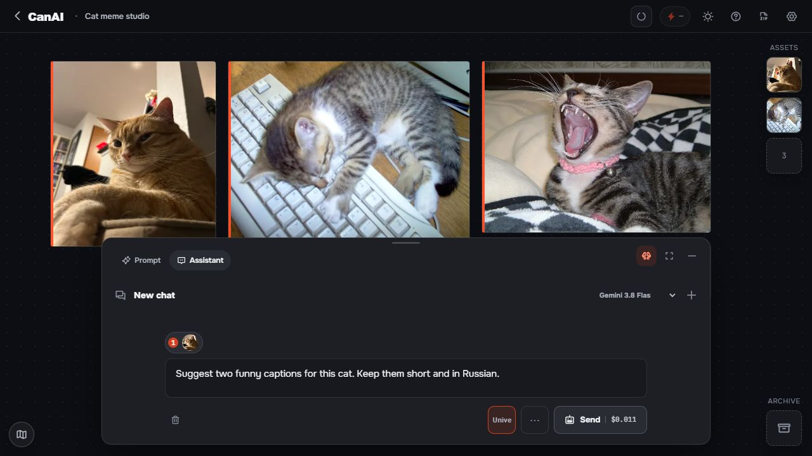

# CanAI

**A local visual studio for references, generation, comparison, and repeatable workflows.**

Gather references → generate images, video, or audio → compare the results → reuse the best work in Assistant and Workflows.

[Download the Windows preview](https://github.com/jimmorisedu-boop/CanAI-public/releases) · [Get started](docs/GETTING-STARTED.md) · [Visual Help](docs/help/README.md) · [User Guide](USER-GUIDE.md) · [Tablet guide](TABLET-GUIDE.md)


Start with a reference board, try a few visual directions, and keep a storyboard or client asset set together while you work. The same board can move from a rough idea to a chosen result, a prompt from Assistant, or a repeatable Macro.

## What you can do

- **Build a reference board.** Import photos or video, add notes, and keep the source material visible while you work.
- **Generate several directions.** Use image, video, and audio models from Prompt; use Assistant and Workflows when the next step is text or a repeatable recipe.
- **Reuse the work.** Pin useful media in **Assets**, attach a specific item to one Assistant message, or save a repeatable sequence as a **Workflow** or **Macro**.
- **Keep control locally.** Your boards and working files stay with the local app, with recovery and resumable jobs when work is interrupted.
- **Continue from another screen.** The tablet page connects to the same local backend over a trusted LAN; the computer remains the source of truth.

## See the workspace

The screenshots show the current dark workspace with ordinary imported board content.

### Ask for a better prompt



Attach a board item to Assistant for a prompt, explanation, or next step. A prompt response can be copied, used in the Prompt bar, or added as a text card.

### Keep references one click away


Pin a reusable result in **Assets**. Assets are a library; an Assistant attachment is the exact item sent with one message.

### Save repeated steps as a Macro


Connect nodes, save the sequence as a Macro, and run it from the Canvas when the same recipe comes back.

### Continue on your tablet


Open the local tablet page over Wi-Fi while the computer keeps the backend and files.

### Learn with illustrated Help


Open `?` for task-based Help with search, categories, and illustrated steps. The generated [Help index](docs/help/README.md) is also readable outside the app.

### Follow one real workflow


Pick up an existing board or start a new one from the Gallery.


Attach a reference to Prompt and keep the source visible while you explore a direction.


Open Assistant full screen when a prompt needs more room, with the exact board item attached to the message.


Compare a reference and its candidate in Curtain, Switching, or Difference view.


Scrub a local clip, step through frames, cut or crop it, and capture a frame without replacing the source item.


Recover a deleted board from Trash when you need its chats and backups again.


Inspect earlier board snapshots and restore one as a new board.

## Install the Windows preview

The current tagged preview is **CanAI Local Studio Preview 0.1.0** for Windows x64. Download `CanAI-0.1.0-windows-x64.zip` and its SHA-256 sidecar from [Releases](https://github.com/jimmorisedu-boop/CanAI-public/releases).

1. Extract the ZIP into a new folder; keep the old folder until the boards have been checked.
2. Double-click **Start CanAI.bat**. The launcher opens the local app at `http://127.0.0.1:8787` or the next free port.
3. In **Settings → fal.ai and models**, add your own fal.ai API key before real generation. Stop with **Stop CanAI.bat**.

The first start may download the portable Node.js runtime and install server dependencies, so network access is needed. fal.ai charges generation to your account according to the selected model; CanAI does not include provider credits. Only the Windows package is verified for this preview. macOS and Linux source builds are useful for contributors, but there is no verified package for those systems in 0.1.0.

Screenshots on this page come from the current development source and may show small UI differences from the tagged preview while the next release is prepared.

## Build from source

For development or an unverified platform, use Node.js 22.23.1:

```sh
npm run setup
npm run dev
```

The Vite client uses port `5173`; the local Express backend uses `8787` by default. `CANAI_MOCK=1` is an explicit developer-test mode and never turns on because a key is missing. See [Getting Started](docs/GETTING-STARTED.md) for the first-run path and [CONTRIBUTING.md](https://github.com/jimmorisedu-boop/CanAI-public/blob/main/CONTRIBUTING.md) for checks.

## License

Use the [CanAI Community License 1.0](LICENSE). It permits personal and internal business use, forks, redistribution, client work, and selling content or services made with CanAI. It does not permit selling CanAI itself or offering paid hosted, managed, or per-use access to CanAI. The license is source-available rather than OSI Open Source; see [third-party notices](THIRD-PARTY-NOTICES.md).

## Contributing and security

Read [CONTRIBUTING.md](https://github.com/jimmorisedu-boop/CanAI-public/blob/main/CONTRIBUTING.md). Report vulnerabilities through [SECURITY.md](https://github.com/jimmorisedu-boop/CanAI-public/blob/main/SECURITY.md) when private reporting is enabled, and never post API keys or private data.

<details>
<summary>Technical, data, and release notes</summary>

### Repository roles

- Development/source: `F:\Exp\CanAI` (logical name **CanAI-dev**, private repository `jimmorisedu-boop/CanAI`).
- Production/release: `F:\Exp\CanAI-public` (`jimmorisedu-boop/CanAI-public`). The release repository remains private pending an explicit visibility action.
- Prepare a release from a clean development checkout with `npm run release:prepare`. The generated checkout is not the authoring tree.

### Data and backup

Boards and versions live under `server/data/projects/`; media under `server/data/media/`; jobs under `server/data/jobs.json`; prompt chats under `server/data/prompt-chats/`; settings under `server/data/settings.json`; and the fal.ai key under `server/.env`. Stop CanAI and copy the whole folder for a private backup. To update, extract a new ZIP into a new folder and run **Migrate data.bat**; it copies `server/data/` and `server/.env` while leaving the old folder intact.

### Guides and public contracts

[Visual Help index](docs/help/README.md) · [User Guide](USER-GUIDE.md) · [Tablet Guide](TABLET-GUIDE.md) · [release checklist](https://github.com/jimmorisedu-boop/CanAI-public/blob/main/docs/RELEASING.md) · [Design guide](https://github.com/jimmorisedu-boop/CanAI-public/blob/main/DESIGN.md) · [agent protocol](https://github.com/jimmorisedu-boop/CanAI-public/blob/main/docs/agents/README.md) · [public contributor notes](https://github.com/jimmorisedu-boop/CanAI-public/blob/main/AGENTS.md)

The production source release is the local edition: local boards, the Express backend, fal.ai generation, workflows, and tablet access to your computer over LAN. CanAI Cloud, shared network boards, collaboration, Cloud accounts and bridges are excluded. The full network edition remains in the development repository.

</details>
