# Getting started with CanAI

CanAI is a local workspace for turning references into media and repeatable work. The computer keeps the board and local backend; fal.ai supplies generation when you add your own key. The screenshots show the current dark workspace with ordinary imported board content.

## 1. Install and open the workspace

On Windows, download the current **CanAI Local Studio Preview 0.1.0** from [Releases](https://github.com/jimmorisedu-boop/CanAI-public/releases), extract it into a new folder, and run **Start CanAI.bat**. The launcher opens the local app at `http://127.0.0.1:8787` or the next free port.

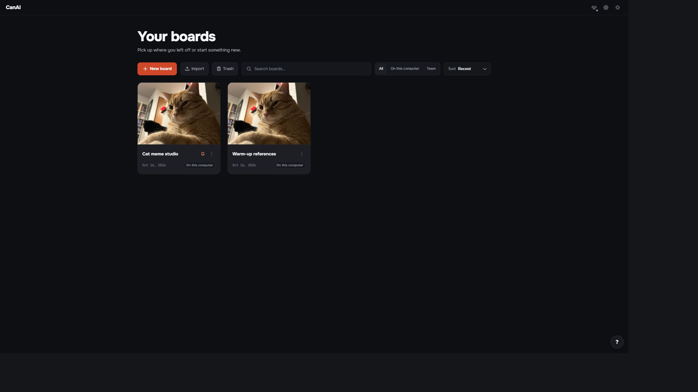

The first run may install the portable runtime and server dependencies. Keep the launcher window open while the app runs. Stop with **Stop CanAI.bat**.

## 2. Bring in a reference

Drop an image or video onto the Canvas, paste a file, or use the file picker. Add a text card for the direction you want to explore. Keep the source visible while you write the prompt.

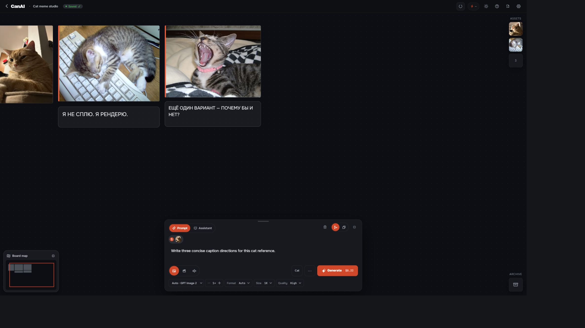

The image, video, and text remain local board items. A URL pasted as text stays a link card until you choose to import it.

## 3. Generate and review a result

Choose **Image**, **Video**, or **Audio** in the Prompt bar. Select a model, review its parameters and estimate, then press **Generate**. Real generation requires a fal.ai API key in **Settings → fal.ai and models**; provider pricing belongs to your fal.ai account.

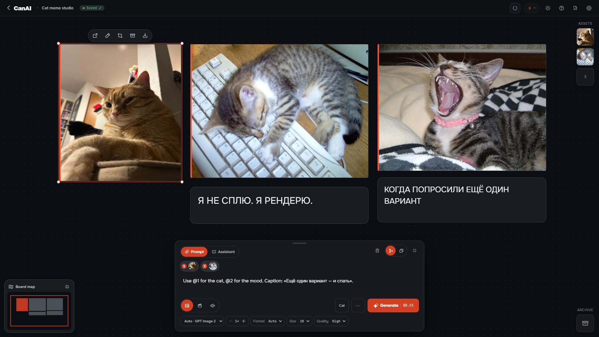

CanAI places completed results near their references. Open Tasks to cancel or retry work. A saved provider request can resume after a restart without submitting the same paid request twice.

## 4. Reuse work in Assets and Assistant

Pin a result in **Assets** when you want a library item available across the board. Drag a particular board item into **Assistant** when that exact file should accompany one message. These are different paths: Assets are reusable storage; an Assistant attachment is message context.

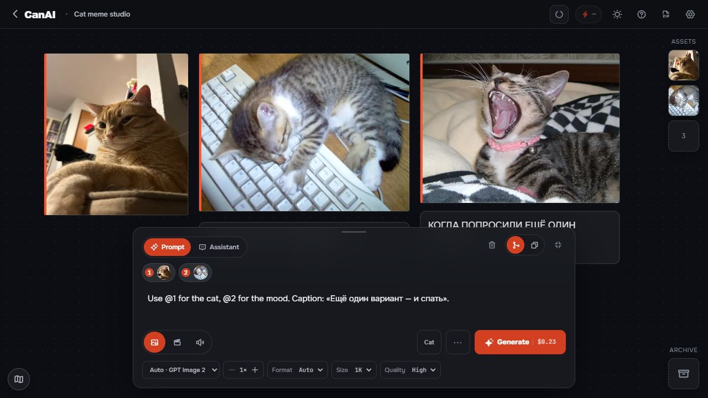

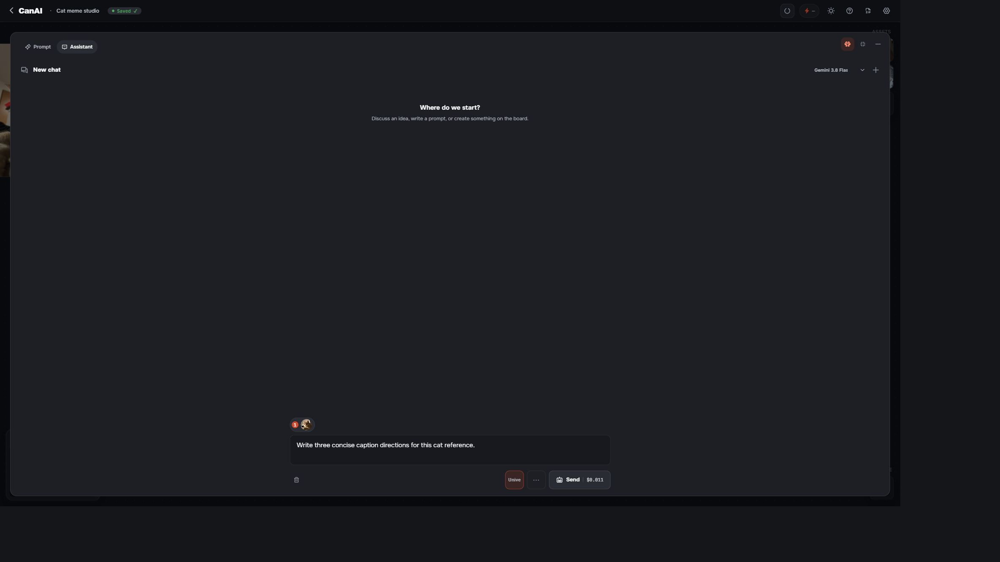

Ask Assistant for an explanation or a ready-to-run prompt. **Use prompt** fills the Prompt bar, **Add to canvas** creates a text card, and **Generate** starts a media request only after the normal confirmation and quote flow.

## 5. Compare, edit, and repeat

Keep alternate results together, compare versions, and use the canvas crop, sketch, and editor actions when a result needs another pass. Save a repeatable sequence as a **Workflow** or **Macro** and run it again from the Canvas.

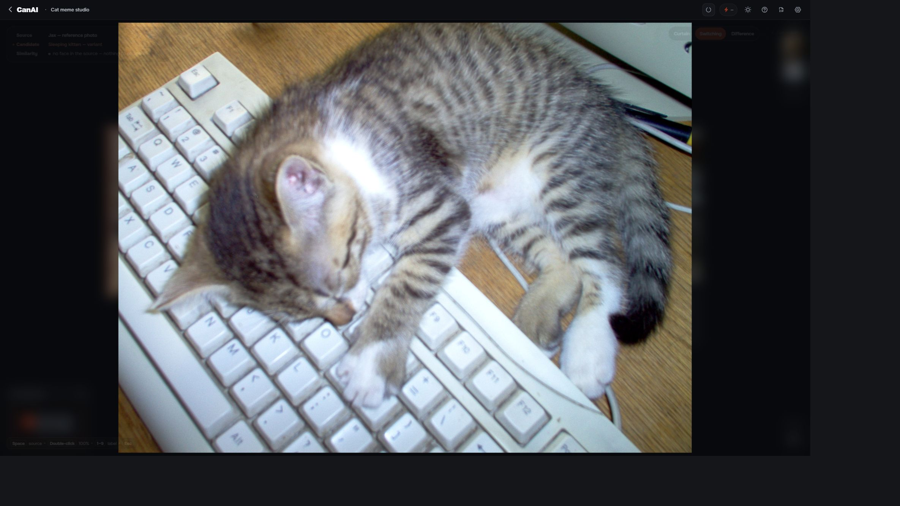

Compare a reference with a candidate in Curtain, Switching, or Difference view.

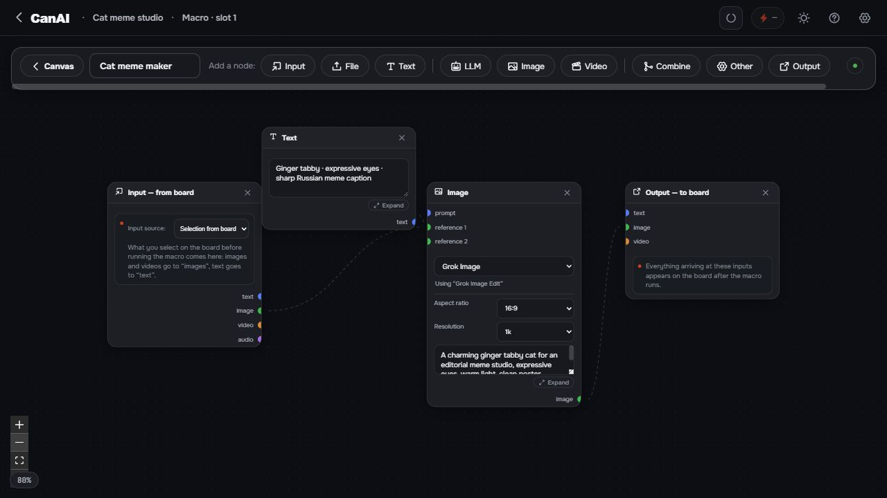

Use the local timeline to scrub, step through frames, cut or crop a clip, mute preview audio, and capture a frame. Applying edits creates the edited result while the source board item remains available.

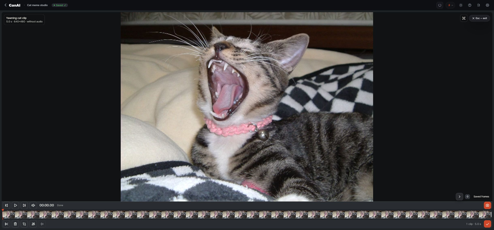

## 6. Recover, export, and continue on a tablet

Deleted boards go to **Trash** first. Board versions let you inspect an earlier snapshot and restore it. For a private backup, stop CanAI and copy the entire installation folder, including `server/data/` and `server/.env`; never share the key file.

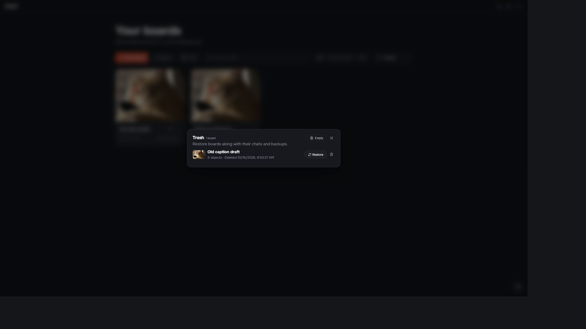

Trash keeps a deleted board recoverable with its chats and backups.

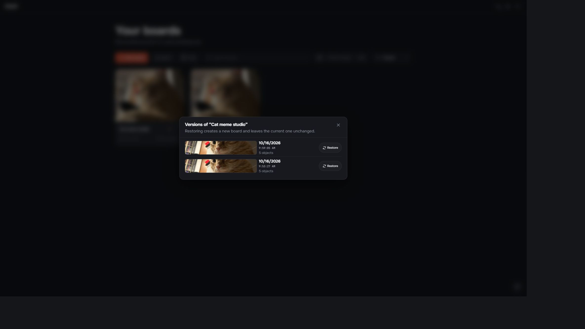

Versions lets you inspect an earlier board snapshot before restoring it as a new board.

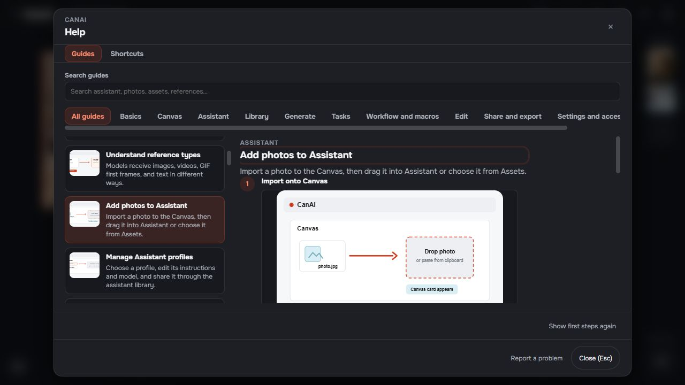

Open `?` for task-based Help with search, categories, and illustrated steps.

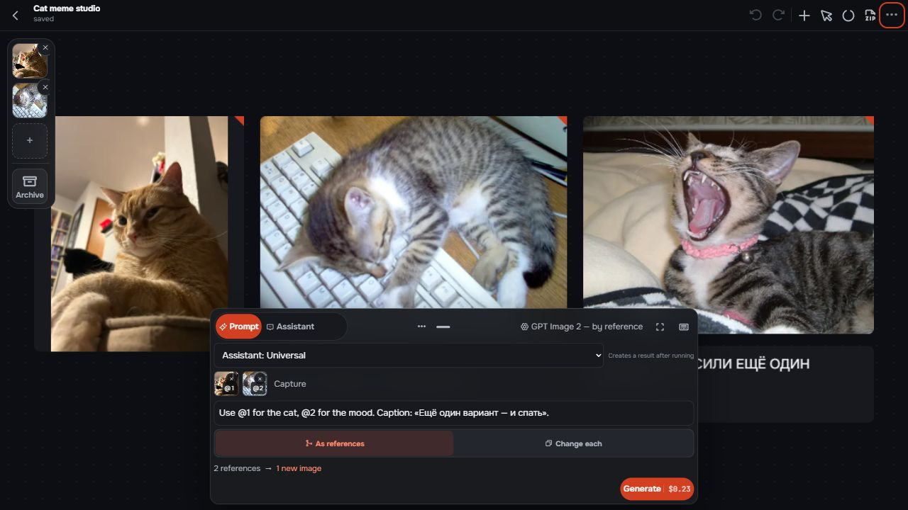

The tablet page mirrors the local board over a trusted LAN while the computer remains the source of truth.

## Where to read next

- [Visual Help index](help/README.md) — the generated task-based Help with topic pages and illustrations.
- [User Guide](../USER-GUIDE.md) — start/stop, recovery, data locations, Assistant, models, and troubleshooting.
- [Tablet Guide](../TABLET-GUIDE.md) — LAN setup and tablet-specific controls.

For development or an unverified platform, use Node.js 22.23.1 and run `npm run setup` followed by `npm run dev`. `CANAI_MOCK=1` is an explicit developer-test mode; it does not turn on automatically when a key is absent. Only the Windows package is verified for the 0.1.0 preview.
