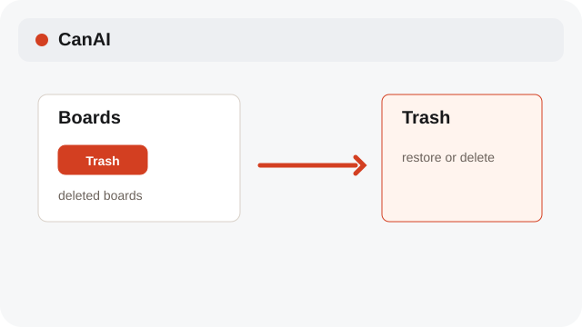
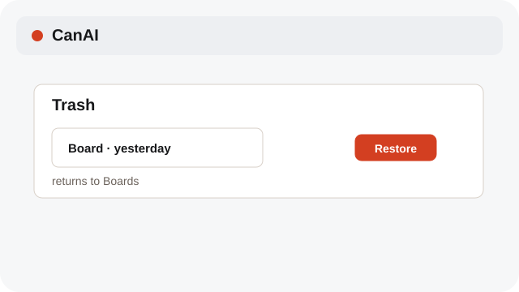
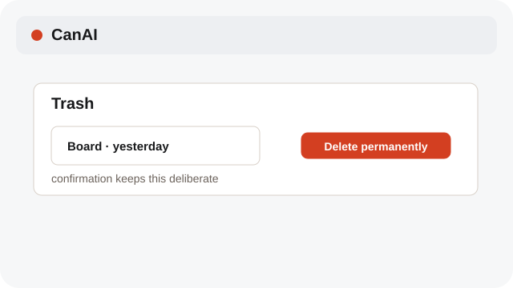

# Restore or delete from Trash

Trash gives you a recovery step before permanent deletion.

**Category:** [Library](./README.md#library)

## Steps

### 1. Open Trash

Choose Trash in the board list to see deleted boards.

### 2. Restore

Choose Restore to return a board to the active list with its local files.

### 3. Delete permanently

Choose Delete permanently only when you are sure the board and its data are no longer needed.

## Related topics

- [Keep a board tidy](./library.md)
- [Use board Versions](./versions.md)

---

[Help index](./README.md) · [README](../../README.md) · [Getting started](../../docs/GETTING-STARTED.md)
