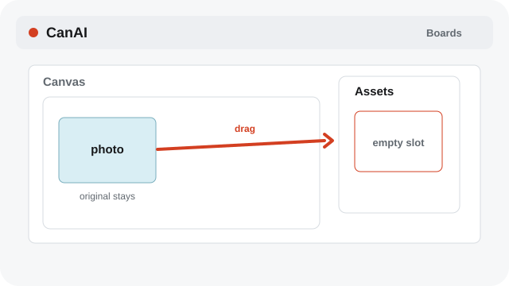
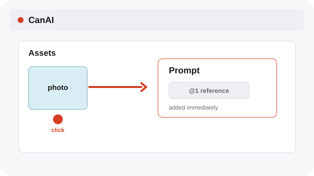
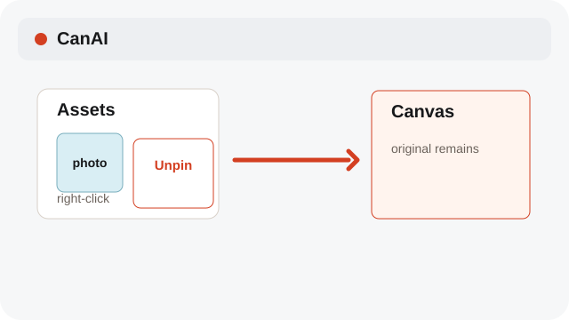

# Use the Assets shelf

Keep reusable media on the current board without removing it from the Canvas.

**Category:** [Library](./README.md#library)

## Steps

### 1. Pin a card

Drag a Canvas card or a file into an empty Assets slot. The original Canvas item stays where it is.

### 2. Use an asset

Click an asset to add it to the current composer or attach it in Assistant.

### 3. Unpin it

Right-click an asset to unpin it. The Canvas item and local file remain available.

## Notes

- The shelf is per board. Assets do not become a second copy of your media file.

## Related topics

- [Add photos to Assistant](./assistant-photos.md)
- [Keep a board tidy](./library.md)
- [Restore or delete from Trash](./archive-trash.md)

---

[Help index](./README.md) · [README](../../README.md) · [Getting started](../../docs/GETTING-STARTED.md)
