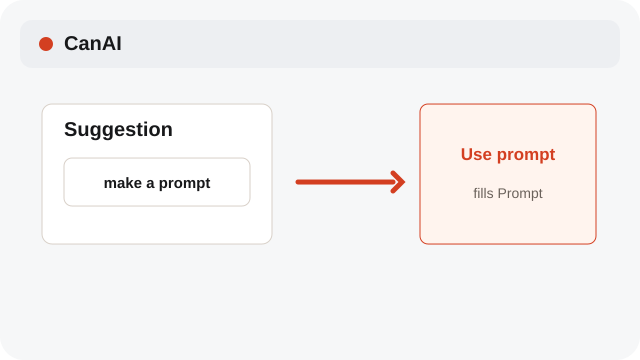
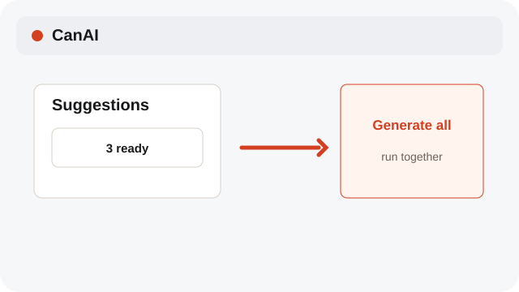
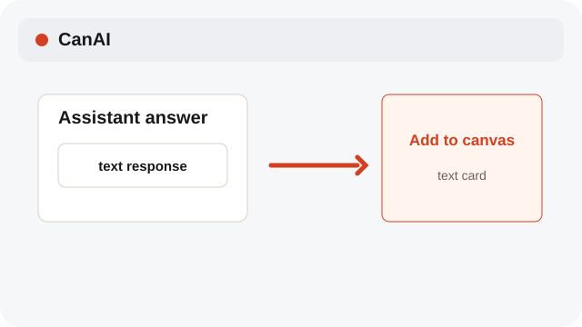
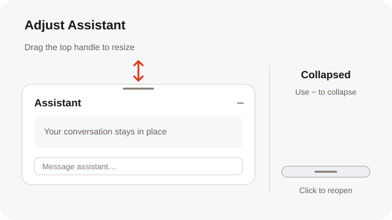

# Use Assistant actions

Turn a suggestion into a prompt, run all suggestions, or place text on the Canvas.

**Category:** [Assistant](./README.md#assistant)

## Steps

### 1. Use prompt

Choose Use prompt to copy a suggestion into the composer for review.

### 2. Generate all

Choose Generate all to run the eligible suggestions together after their quote and confirmations.

### 3. Add to canvas

Choose Add to canvas to place the assistant response as a text card.

### 4. Adjust the panel

Drag the top handle to resize Assistant. Use − to collapse it; click the bottom handle to open it again. Your draft and conversation stay in place.

## Notes

- Assistant errors and status labels use English. Chat messages and your own instructions keep their original language.
- System labels follow the selected interface language; Assistant prompts, profile instructions, and chat messages remain in their original language.

## Related topics

- [Run an Assistant request](./assistant-run.md)
- [Manage Assistant chats](./assistant-chats.md)
- [Choose Together or Each](./generation-modes.md)

---

[Help index](./README.md) · [README](../../README.md) · [Getting started](../../docs/GETTING-STARTED.md)
