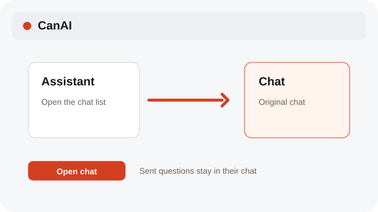

# Manage Assistant chats

Create, rename, archive, and restore chats; choose a model from Assistant's Chat model menu.

**Category:** [Assistant](./README.md#assistant)

## Steps

### 1. Open the chat list

Use the Assistant chat list to switch between saved conversations. A sent question stays in its original chat while references are prepared.

### 2. Create or manage

Choose New chat, then use the chat row menu to Rename or Delete it.

### 3. Restore and choose a model

Choose a model from Assistant's Chat model menu. Move a chat to Trash; restore it or delete it permanently from Trash.

## Notes

- System labels follow the selected interface language; Assistant prompts, profile instructions, and chat messages remain in their original language.

## Related topics

- [Use Assistant actions](./assistant-basics.md)
- [Restore or delete from Trash](./archive-trash.md)
- [Pick Auto or a model](./models.md)

---

[Help index](./README.md) · [README](../../README.md) · [Getting started](../../docs/GETTING-STARTED.md)
