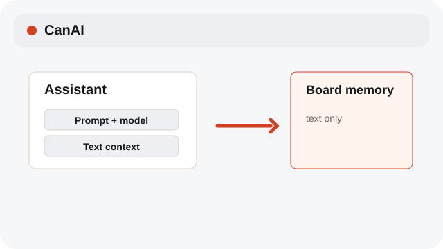
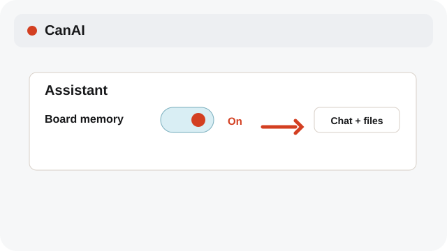
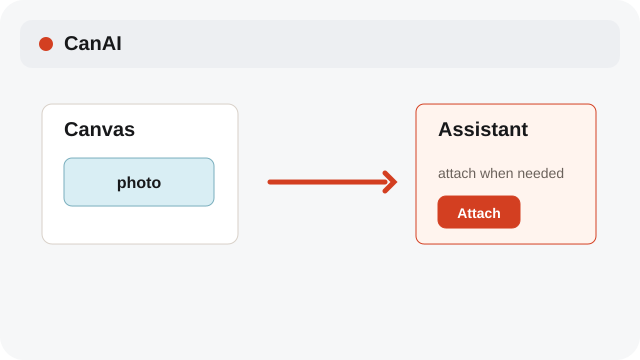

# Choose board memory

Board memory keeps prompt, model, and text context; it does not see every photo automatically.

**Category:** [Assistant](./README.md#assistant)

## Steps

### 1. Open memory

Use the Board memory control in Assistant to review what context is available.

### 2. Toggle context

Turn memory on or off for the chat. Attachments and chat history remain separate controls.

### 3. Attach only when needed

Add a photo to the chat only when you want Assistant to receive that image.

## Notes

- Board memory is text and generation context. It is not automatic visual access to all images on the board.
- System labels follow the selected interface language; Assistant prompts, profile instructions, and chat messages remain in their original language.

## Related topics

- [Add photos to Assistant](./assistant-photos.md)
- [Use Canvas references](./references.md)

---

[Help index](./README.md) · [README](../../README.md) · [Getting started](../../docs/GETTING-STARTED.md)
