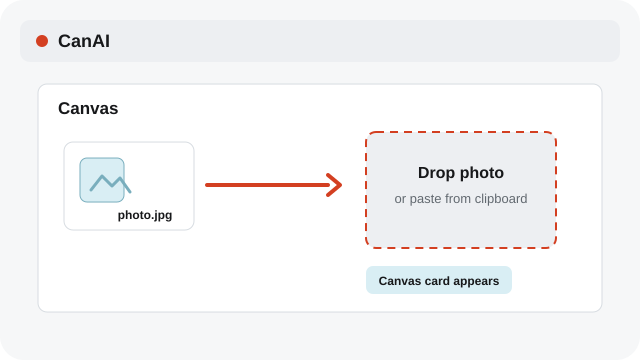
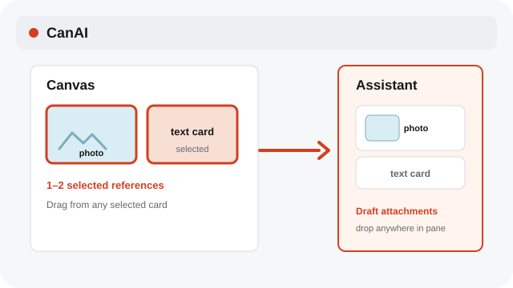
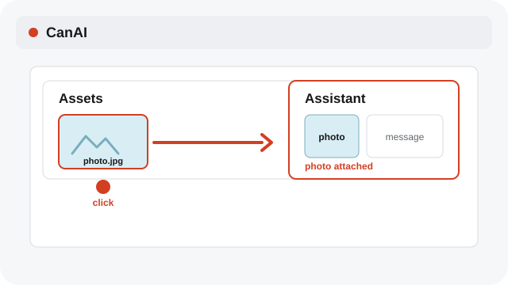

# Attach Canvas references to Assistant

Select Canvas media or text, then drag it into Assistant to add it to the draft.

**Category:** [Assistant](./README.md#assistant)

## Steps

### 1. Import onto Canvas

Drop or paste the photo on the Canvas and wait until its card appears.

### 2. Select and drag references

Select one or more media or text cards, then drag from any selected card to any part of the Assistant pane. Every supported selection is added to the draft attachments; the Canvas cards stay in place.

### 3. Or click an Assets thumbnail

With Assistant open, click the pinned thumbnail in Assets to add it to the composer.

### 4. Check the draft attachments

Confirm the supported references appear in the draft attachments. Dropping adds them to the draft; it does not send the Assistant message.

## Notes

- The original Canvas cards stay in place when you attach references.
- Dropping the same card again does not create a duplicate attachment.
- Selecting a Canvas item alone does not attach it; drag the selection into Assistant or click an Assets thumbnail.
- System labels follow the selected interface language; Assistant prompts, profile instructions, and chat messages remain in their original language.

## Related topics

- [Use the Assets shelf](./assets.md)
- [Edit Prompt and Assistant references](./assistant-refs.md)
- [Use Canvas references](./references.md)

---

[Help index](./README.md) · [README](../../README.md) · [Getting started](../../docs/GETTING-STARTED.md)
