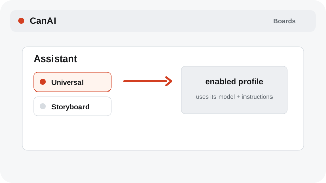
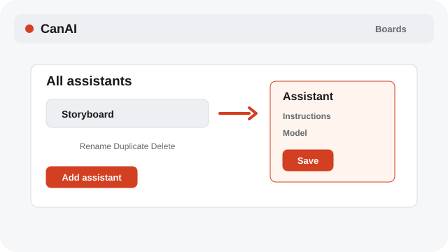
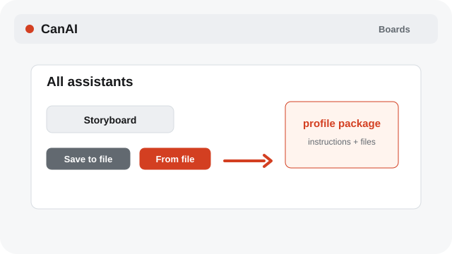

# Manage Assistant profiles

Choose a profile, edit its instructions and model, and share it through the assistant library.

**Category:** [Assistant](./README.md#assistant)

## Steps

### 1. Choose a profile

Click Universal or a named assistant to enable it. Click the enabled profile again to return to Universal.

### 2. Edit or add

Open Manage assistants (⋯) to add, rename, duplicate, or delete a profile. Edit its instructions and model, then Save.

### 3. Import or save a file

Use From file to import an assistant package, or Save to a file to reuse its instructions and text documents elsewhere.

## Notes

- A profile combines instructions, one text model, and optional text documents. It does not replace the local provider connection.
- System labels follow the selected interface language; Assistant prompts, profile instructions, and chat messages remain in their original language.

## Related topics

- [Manage Assistant chats](./assistant-chats.md)
- [Edit Prompt and Assistant references](./assistant-refs.md)
- [Pick Auto or a model](./models.md)

---

[Help index](./README.md) · [README](../../README.md) · [Getting started](../../docs/GETTING-STARTED.md)
