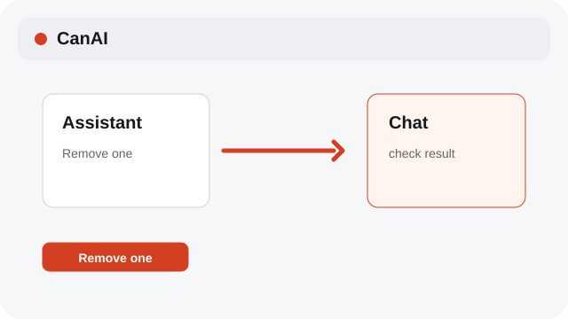

# Edit Prompt and Assistant references

Add, remove, and replace references in Prompt; Assistant attachments are removed and added again.

**Category:** [Assistant](./README.md#assistant)

## Steps

### 1. Add references

Attach several Canvas items or Assets; the Prompt bar labels them @1, @2, and so on.

### 2. Replace in Prompt

In Prompt, double-click a reference thumbnail and choose its replacement. In Assistant, remove the attachment and add the new item.

### 3. Remove one

Right-click a thumbnail to remove it from the current references; the Canvas item stays available.

## Notes

- System labels follow the selected interface language; Assistant prompts, profile instructions, and chat messages remain in their original language.

## Related topics

- [Attach Canvas references to Assistant](./assistant-photos.md)
- [Use the Assets shelf](./assets.md)
- [Understand reference types](./reference-kinds.md)

---

[Help index](./README.md) · [README](../../README.md) · [Getting started](../../docs/GETTING-STARTED.md)
