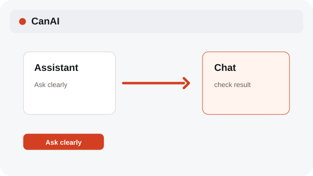

# Run an Assistant request

Assistant explains a request, quotes it, and follows your confirmation settings.

**Category:** [Assistant](./README.md#assistant)

## Steps

### 1. Ask clearly

Describe whether you want a prompt, a text card, or new media on the Canvas.

### 2. Review the quote

Send shows the estimated cost and required confirmations follow your settings.

### 3. Confirm the action

An explicit request to create or edit media can start generation; a prompt-only request does not.

## Notes

- Provider connections and paid calls are explicit. A model reply alone never grants a generation request.
- System labels follow the selected interface language; Assistant prompts, profile instructions, and chat messages remain in their original language.

## Related topics

- [Use Assistant actions](./assistant-basics.md)
- [Review variants and cost](./variants-cost.md)
- [Configure providers and models](./settings-provider.md)

---

[Help index](./README.md) · [README](../../README.md) · [Getting started](../../docs/GETTING-STARTED.md)
