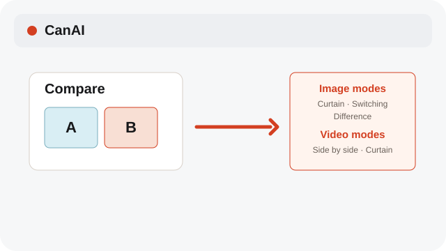
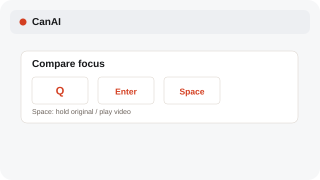
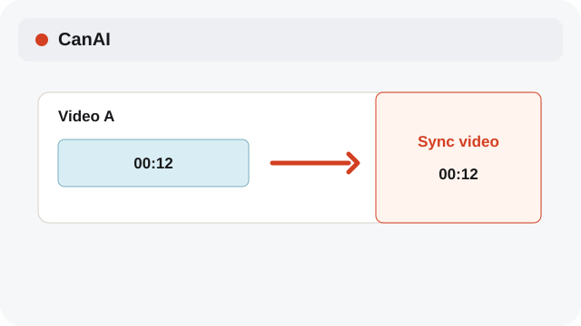

# Compare versions and results

Compare images with Curtain, Switching, or Difference; compare videos with Side by side or Curtain.

**Category:** [Edit](./README.md#edit)

## Steps

### 1. Open Compare

Select two compatible image or video cards and choose Compare.

### 2. Change the view

Press Q to start a candidate set, click items to add them, then press Enter to open Compare. Images offer Curtain, Switching, or Difference; videos offer Side by side or Curtain.

### 3. Sync video

Turn on Sync video to keep playback position aligned between the two cards.

## Notes

- System labels follow the selected interface language; edit operations preserve the source content.

## Shortcuts

- **Q** — Start a candidate set
- **Click** — Add or remove a candidate
- **Enter** — Open Compare
- **Space — hold** — Show the original; on video, play or pause

## Related topics

- [Trim video on the timeline](./timeline.md)
- [Restore a generation setup](./restore-generation.md)

---

[Help index](./README.md) · [README](../../README.md) · [Getting started](../../docs/GETTING-STARTED.md)
