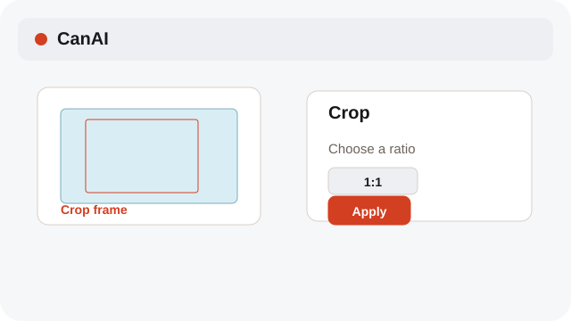
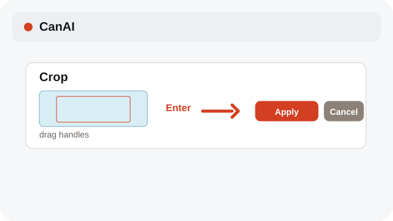
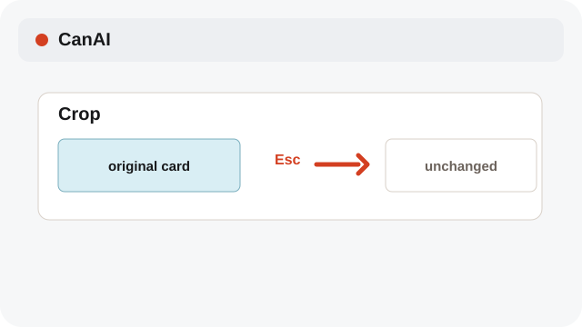

# Crop an image

Crop a card in place and keep the change undoable.

**Category:** [Edit](./README.md#edit)

## Steps

### 1. Open Crop

Choose Crop from a selected image card’s context menu.

### 2. Set the frame

Choose a ratio or drag the crop frame, then press Enter or choose Apply.

### 3. Cancel safely

Press Esc or choose Cancel to leave the original card unchanged.

## Notes

- Crop Apply updates the image in place and remains undoable.

## Related topics

- [Navigate the Canvas quickly](./navigation-shortcuts.md)
- [Use the external editor](./external-editor.md)

---

[Help index](./README.md) · [README](../../README.md) · [Getting started](../../docs/GETTING-STARTED.md)
