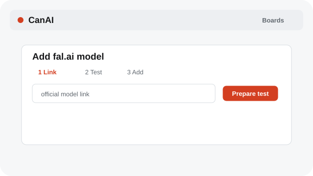
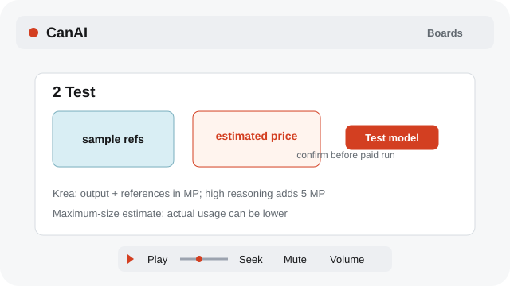
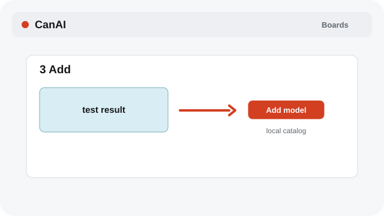

# Add a custom fal.ai model

Link a fal.ai model, review its setup and price, run a confirmed test, then add the result to the catalog.

**Category:** [Settings and access](./README.md#settings-and-access)

## Steps

### 1. Link the model

Open Settings → fal.ai and models, paste the official model link, and choose Prepare test.

### 2. Review and test

Check the prepared references, parameters, and estimated test price. For Krea 3 Edit, the megapixel estimate allows for the maximum output size, each reference, and the selected reasoning level. Choose Test model and confirm the paid test.

### 3. Add the result

Wait for the test result, inspect it, then choose Add model to publish the tested model into your local catalog.

## Notes

- A changed test file recalculates the estimate. A model cannot be added until a valid result arrives.
- Model discovery and test errors use English. Model names and sample prompts keep their original language.
- Use Play or Pause below a media preview. Drag Seek to jump; Mute and Volume change its sound.

## Related topics

- [Configure providers and models](./settings-provider.md)
- [Pick Auto or a model](./models.md)
- [Review variants and cost](./variants-cost.md)

---

[Help index](./README.md) · [README](../../README.md) · [Getting started](../../docs/GETTING-STARTED.md)
