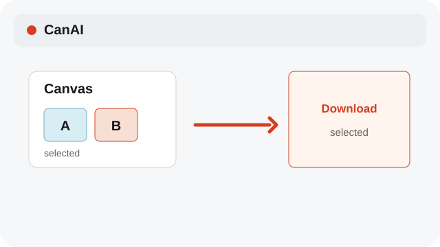
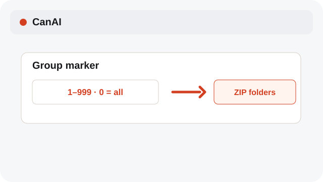
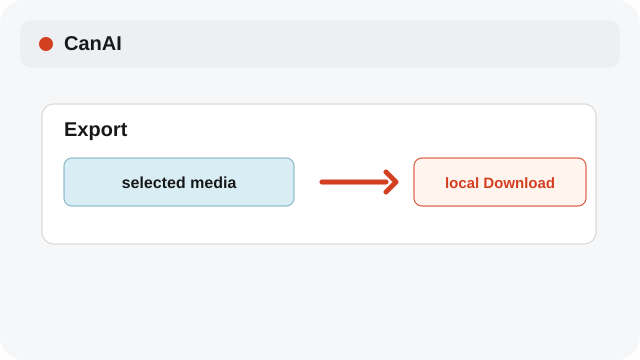

# Export selected results

Download selected cards or export grouped folders without changing board data.

**Category:** [Share and export](./README.md#share-and-export)

## Steps

### 1. Select cards

Select one or more image, video, audio, or text cards on the Canvas.

### 2. Choose a group

Assign a marker from 1 to 999 to selected cards; enter 0 to remove a marker. Grouped export uses the selected marker.

### 3. Download

Choose Download selected or export a ZIP folder to a real local destination.

## Notes

- Export copies user content. It does not publish a board or grant provider rights.
- Markers are selection metadata for grouped export; 0 clears the marker.
- System labels follow the selected interface language; source filenames and clip names remain as entered.

## Related topics

- [Import a .canai board](./project-files.md)
- [Keep a board tidy](./library.md)
- [Trim video on the timeline](./timeline.md)

---

[Help index](./README.md) · [README](../../README.md) · [Getting started](../../docs/GETTING-STARTED.md)
