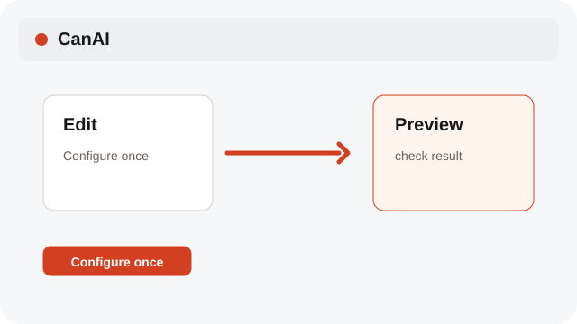
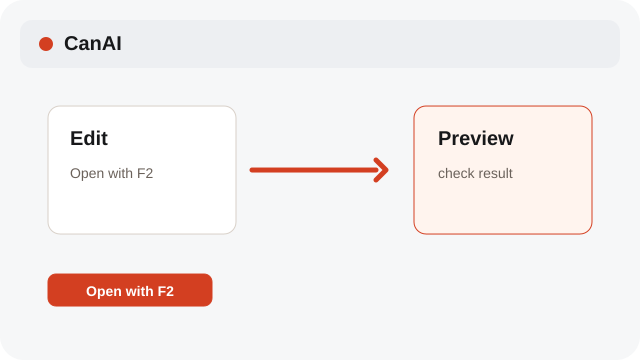
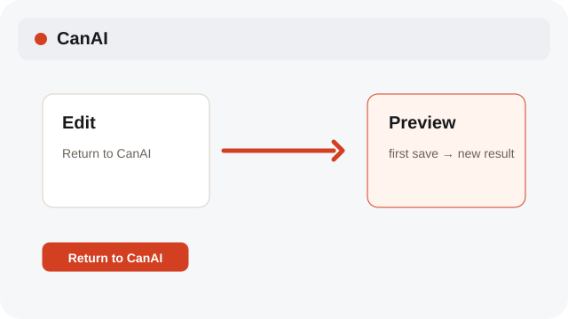

# Use the external editor

F2 opens the configured editor; the first save creates a new result beside the source, and later saves update that result.

**Category:** [Edit](./README.md#edit)

## Steps

### 1. Configure once

Open Settings and set the external editor path, then use Test to confirm it starts.

### 2. Open with F2

Select an image and press F2, or choose External editor from its menu.

### 3. Return to CanAI

Save in the external editor and return. The first save creates a new result beside the source; later saves update that result.

## Notes

- System labels follow the selected interface language; edit operations preserve the source content.

## Shortcuts

- **F2** — Open the configured external editor

## Related topics

- [Crop an image](./crop-sketch.md)
- [Keep the local app portable](./settings-local.md)

---

[Help index](./README.md) · [README](../../README.md) · [Getting started](../../docs/GETTING-STARTED.md)
