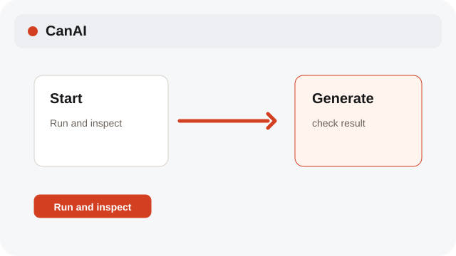

# Make your first result

Use a short prompt and keep the first run easy to inspect.

**Category:** [Basics](./README.md#basics)

## Steps

### 1. Write one idea

Describe the subject, style, and format in the prompt bar.

### 2. Review the model

Auto selects a compatible model; open the model menu to choose another one.

### 3. Run and inspect

Select Generate and wait for the result card to land on the Canvas.

## Notes

- Video jobs can take minutes. The browser stays usable while Tasks tracks progress.

## Related topics

- [Start a local board](./quick-start.md)
- [Pick Auto or a model](./models.md)
- [Track pending jobs](./pending-jobs.md)

---

[Help index](./README.md) · [README](../../README.md) · [Getting started](../../docs/GETTING-STARTED.md)
