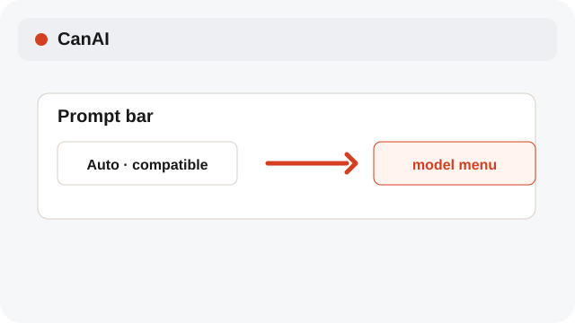
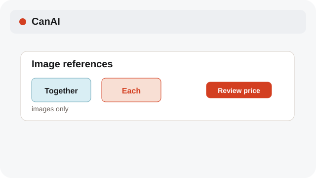
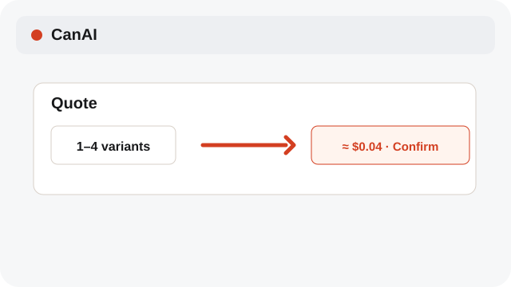

# Choose Together or Each

Image references can be combined in one run or used one at a time.

**Category:** [Generate](./README.md#generate)

## Steps

### 1. Select image references

Attach two or more image references in the prompt bar.

### 2. Choose a mode

Together sends all images to one request. Each makes one request per image.

### 3. Run compatible media

The Together/Each choice applies to image generation only; video and text use their own reference rules.

## Notes

- Each can create multiple paid calls. Review the quote before confirming.

## Related topics

- [Use Canvas references](./references.md)
- [Review variants and cost](./variants-cost.md)
- [Pick Auto or a model](./models.md)

---

[Help index](./README.md) · [README](../../README.md) · [Getting started](../../docs/GETTING-STARTED.md)
