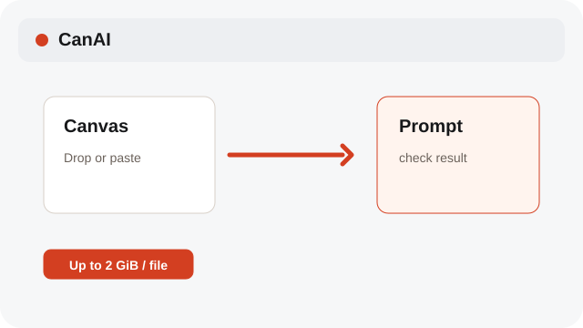
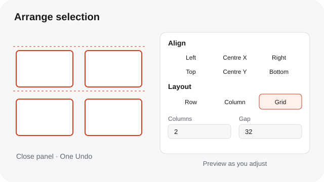

# Import files and screenshots

Drop media onto the Canvas or paste a screenshot; originals stay local.

**Category:** [Canvas](./README.md#canvas)

## Steps

### 1. Drop or paste

Drop image or video files up to 2 GiB each on the Canvas, or paste a screenshot from the system clipboard. Larger files are rejected before upload begins.

### 2. Align or arrange a selection

Select several cards and open Arrange. Align their edges or centres, or choose Row, Column, or Grid. Columns and Gap update the preview immediately. Click outside the panel or press Escape to keep the result as one Undo step.

### 3. Download a link

Paste one HTTPS URL to make a link card, then choose Download to save a local copy.

## Notes

- Imported media stays in the local media library. Text pasted into a prompt remains text.
- All adjustments made while Arrange is open become one Undo step when it closes. Sizes and rotations are preserved. On tablet, select several cards and choose Arrange in the selection actions.

## Related topics

- [Use Canvas references](./references.md)
- [Use the Assets shelf](./assets.md)
- [Navigate the Canvas quickly](./navigation-shortcuts.md)

---

[Help index](./README.md) · [README](../../README.md) · [Getting started](../../docs/GETTING-STARTED.md)
