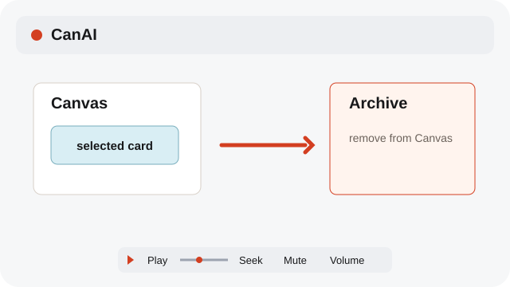
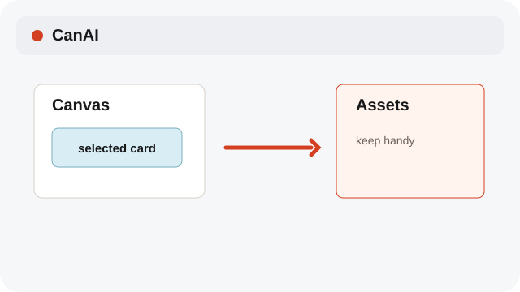
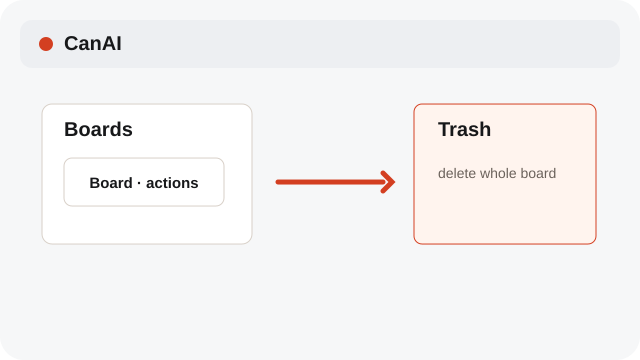

# Keep a board tidy

Assets, archive, and deletion solve different jobs.

**Category:** [Library](./README.md#library)

## Steps

### 1. Save for reuse

Pin a useful card in Assets when you want it available in future prompts on this board.

### 2. Archive a board

Archive a board to hide it from the active list while keeping its data.

### 3. Delete a board

Delete sends a board to Trash. Permanent deletion removes its stored data after confirmation.

## Notes

- Assets belong inside a board. Archive and Trash act on whole boards, not individual references.
- Connection and sign-in notices use English. Board names keep their original language.
- Use Play or Pause below a media preview. Drag Seek to jump; Mute and Volume change its sound.
- System labels follow the selected interface language; source filenames and clip names remain as entered.

## Related topics

- [Use the Assets shelf](./assets.md)
- [Restore or delete from Trash](./archive-trash.md)
- [Use board Versions](./versions.md)

---

[Help index](./README.md) · [README](../../README.md) · [Getting started](../../docs/GETTING-STARTED.md)
