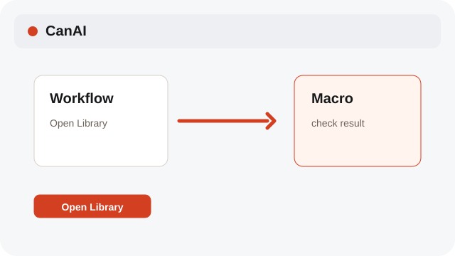
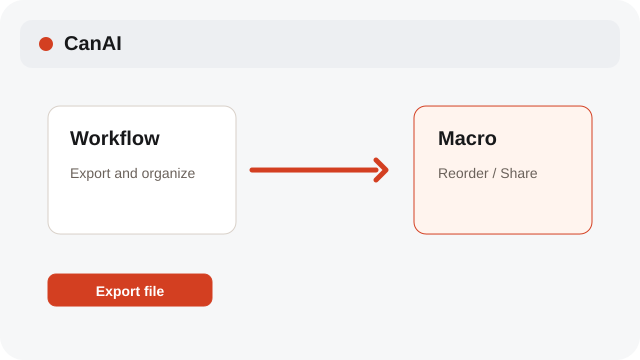

# Manage the Macro Library

Keep reusable workflows in the app-wide Macro Library; duplicate, reorder, export, or import them.

**Category:** [Workflow and macros](./README.md#workflow-and-macros)

## Steps

### 1. Open Library

Open the Macro Library to browse saved workflows and macros.

### 2. Duplicate or import

Choose Duplicate to make another library item, or Import file to add a macro package. The library is shared across the app.

### 3. Export and organize

Use Export file for a local package, drag rows or use Alt+Arrow to reorder, and choose Share when the shared shelf is available.

## Related topics

- [Build a Workflow](./workflow-editor.md)
- [Run and stop macros](./macros.md)
- [Import a .canai board](./project-files.md)

---

[Help index](./README.md) · [README](../../README.md) · [Getting started](../../docs/GETTING-STARTED.md)
