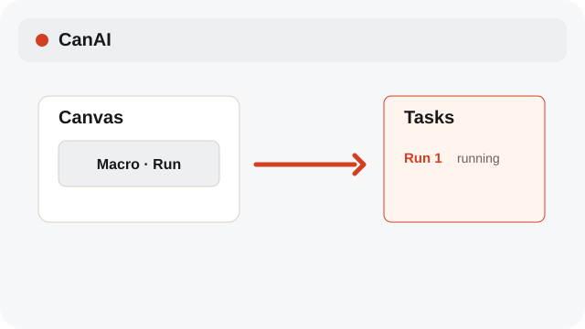
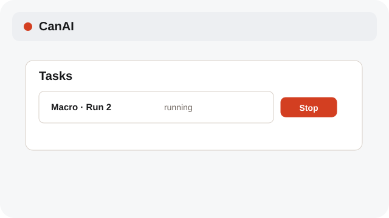
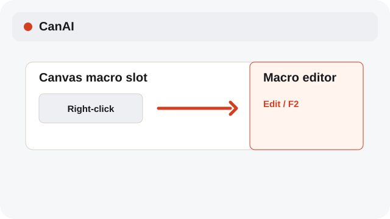

# Run and stop macros

Each macro click starts its own run; stop controls apply to that run only.

**Category:** [Workflow and macros](./README.md#workflow-and-macros)

## Steps

### 1. Start a run

Click a macro slot on the Canvas to launch a run. Click again to start another parallel run.

### 2. Stop one run

Open Tasks, find the run, and choose Stop for that run; other runs continue.

### 3. Edit the macro

Right-click or press F2 to open the Workflow/Macro editor.

## Shortcuts

- **F2** — Edit the selected macro or open the external editor

## Related topics

- [Build a Workflow](./workflow-editor.md)
- [Manage the Macro Library](./macro-library.md)
- [Track pending jobs](./pending-jobs.md)

---

[Help index](./README.md) · [README](../../README.md) · [Getting started](../../docs/GETTING-STARTED.md)
