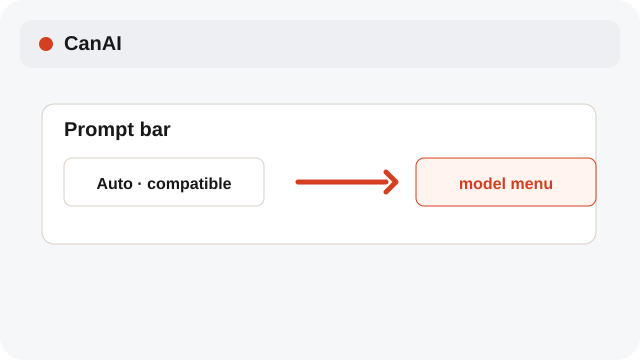
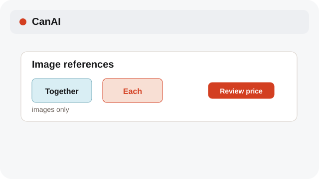
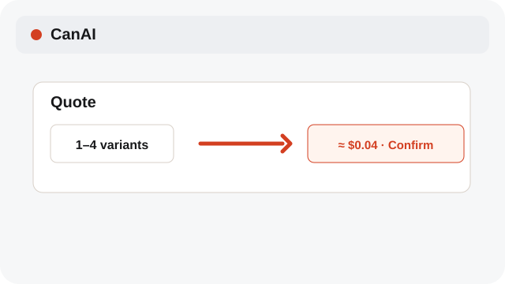

# Pick Auto or a model

Auto chooses a compatible catalog model; manual selection stays exactly as chosen.

**Category:** [Generate](./README.md#generate)

## Steps

### 1. Open the model menu

Choose Auto to let CanAI resolve a model from the media type, references, and limits.

### 2. Choose manually

Select a catalog model when you need its specific controls or style.

### 3. Check support

Confirm the model supports your image, video, audio, or text request before running it.

## Notes

- Unsupported references are reported instead of silently removed. GIF references use their first frame when a model accepts images.
- System labels follow the selected interface language; model IDs, API values, and prompt text are preserved.

## Related topics

- [Understand reference types](./reference-kinds.md)
- [Review variants and cost](./variants-cost.md)
- [Configure providers and models](./settings-provider.md)

---

[Help index](./README.md) · [README](../../README.md) · [Getting started](../../docs/GETTING-STARTED.md)
