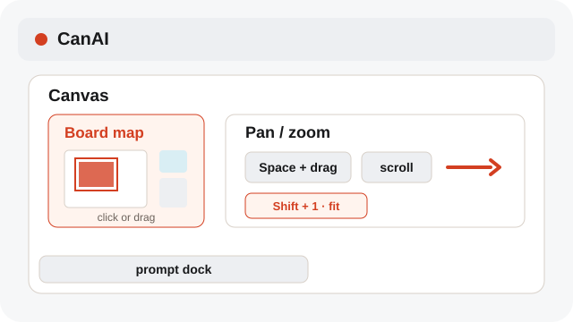
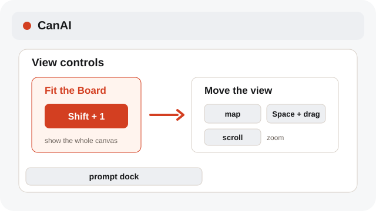
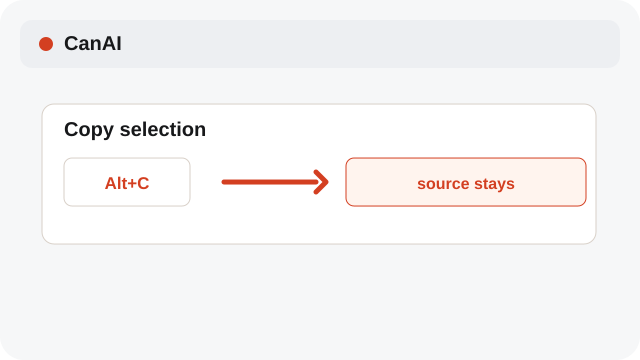
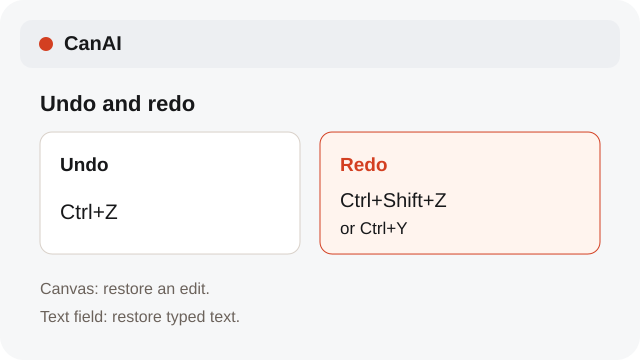

# Navigate the Canvas quickly

Use pan, zoom, copy, and the Board map while you work across the Canvas and Workflow surfaces.

**Category:** [Share and export](./README.md#share-and-export)

## Steps

### 1. Pan and zoom

Hold Space and drag, or drag with the middle mouse button to pan. Scroll to zoom around the pointer. Use the Board map to navigate.

### 2. Fit the board or move around the board

Shift+1 fits the Canvas. Pan or zoom to stop. The person-and-gear icon opens Board access, where managers set View or Edit permissions.

### 3. Copy safely

Hold Alt while dragging to copy the selected item and keep the original in place.

### 4. Undo and redo

Use Ctrl+Z to undo your latest Canvas edit. Press Ctrl+Shift+Z or Ctrl+Y to redo it. Inside a text field, these shortcuts change the text instead of the board.

## Notes

- The Board map stays in the bottom-left corner. Click or drag it to navigate, and collapse it when you need more room.
- On narrow canvases, if the left column overlaps the prompt dock, the map sits 16 px above it.
- The Board map moves your view while keeping the current selection.

## Shortcuts

- **Space + drag** — Pan the Canvas
- **Middle drag** — Pan the Canvas
- **Shift+1** — Fit the Canvas
- **Alt+drag** — Copy the selection in place
- **Ctrl+Z** — Undo the latest Canvas edit
- **Ctrl+Shift+Z / Ctrl+Y** — Redo an undone Canvas edit

## Related topics

- [Import files and screenshots](./import.md)
- [Crop an image](./crop-sketch.md)
- [Compare versions and results](./compare.md)

---

[Help index](./README.md) · [README](../../README.md) · [Getting started](../../docs/GETTING-STARTED.md)
