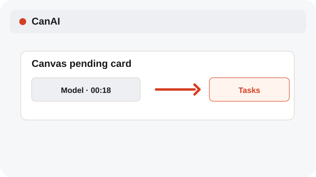
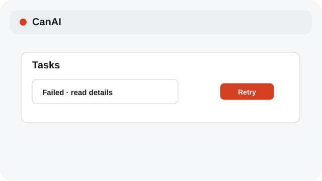
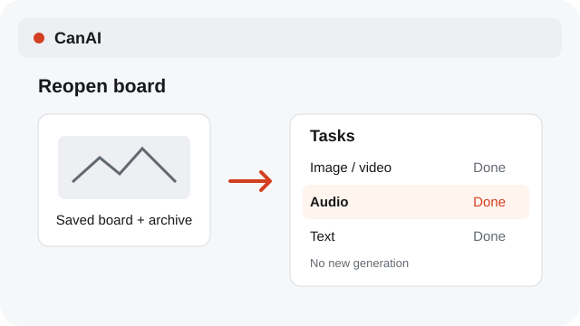

# Track pending jobs

Pending cards and Tasks keep image, video, audio, and text jobs visible.

**Category:** [Tasks](./README.md#tasks)

## Steps

### 1. Watch the card

A pending card shows the model and elapsed time while the job runs.

### 2. Cancel safely

Choose the card’s close button to cancel a queued or running job.

### 3. Open Tasks

Reopen a board to restore its completed image, video, audio, and text jobs in Tasks, including archived results. Restoring the list does not start another generation.

## Related topics

- [Retry a failed job](./tasks-retry.md)
- [Review variants and cost](./variants-cost.md)
- [Restore a generation setup](./restore-generation.md)

---

[Help index](./README.md) · [README](../../README.md) · [Getting started](../../docs/GETTING-STARTED.md)
