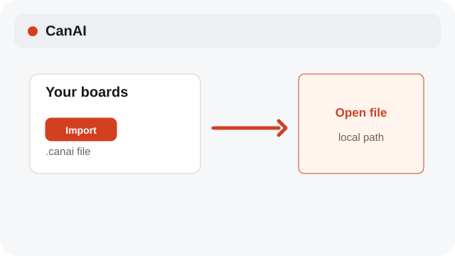
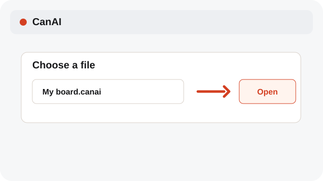
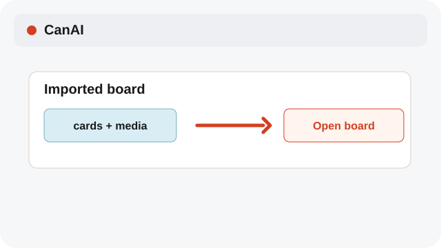

# Import a .canai board

Bring a saved board into the local app through a file you choose.

**Category:** [Library](./README.md#library)

## Steps

### 1. Open Import

On the Boards screen, choose Import.

### 2. Choose a file

Select a .canai file from a real local path.

### 3. Check the board

Open the imported board and confirm its cards and media.

## Notes

- The desktop Boards screen currently imports .canai files. Use Download or a ZIP from the Canvas when you want exported content; both use a real local destination.

## Related topics

- [Use board Versions](./versions.md)
- [Export selected results](./export.md)
- [Keep the local app portable](./settings-local.md)

---

[Help index](./README.md) · [README](../../README.md) · [Getting started](../../docs/GETTING-STARTED.md)
