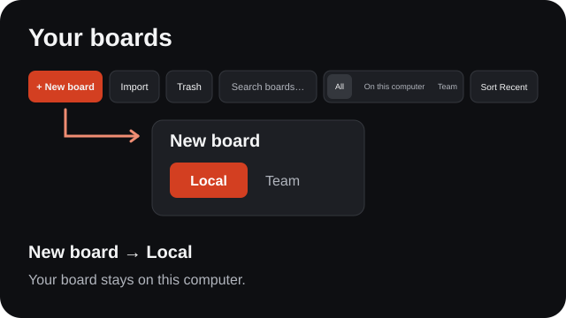
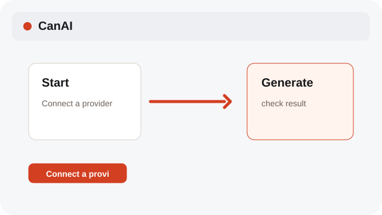
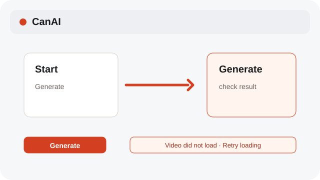

# Start a local board

Open the local studio, connect a provider, and make one small result.

**Category:** [Basics](./README.md#basics)

## Steps

### 1. Open CanAI

Choose New board → Local to keep a board on this computer. Search, filters, and Sort share one desktop toolbar row.

### 2. Connect a provider

In Settings, connect your provider before generating.

### 3. Generate

Enter a prompt, check the quote, and choose Generate.

## Notes

- Generation needs a provider connection. You can still explore boards and edit local content without one.
- Notices and error tooltips use English. Your own content can use any language.
- Missing media shows an English notice. Restore the file, then retry loading.
- System labels follow the selected interface language; board names, prompts, and generated content keep their original language.

## Related topics

- [Make your first result](./first-result.md)
- [Configure providers and models](./settings-provider.md)

---

[Help index](./README.md) · [README](../../README.md) · [Getting started](../../docs/GETTING-STARTED.md)
