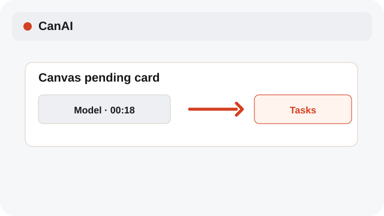
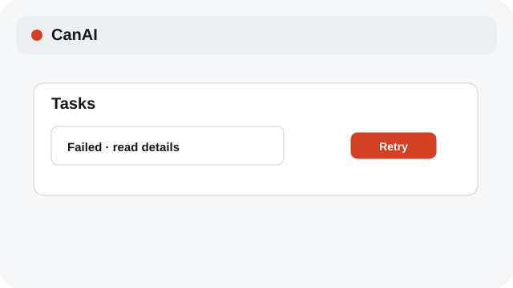
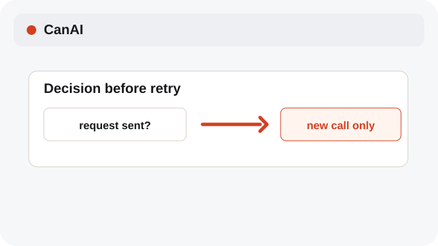
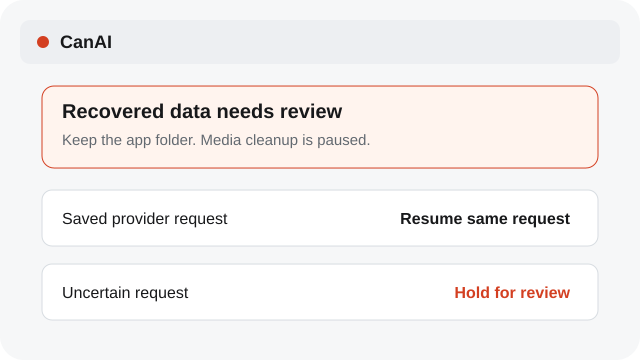

# Recover after a restart

Resume saved work after a normal restart, or review a restored backup without repeating an uncertain paid request.

**Category:** [Recovery](./README.md#recovery)

## Steps

### 1. Reopen the app

Start CanAI again and open Tasks or the board that contained the pending card.

### 2. Wait for restore

Normal restarts resume queued work and saved provider requests. After a backup restore, jobs without a verified request ID are held for review and media cleanup is paused.

### 3. Use Retry deliberately

Choose Retry only after reading the task status; it starts a new provider call.

### 4. Review a recovered backup

Seeing Recovered data needs review? Keep a copy of the whole app folder. Compare boards and Tasks before retrying; repair missing work before resuming cleanup.

## Notes

- A cancelled job does not resume. Keep the app folder intact so saved boards and tasks remain available.
- If both the main state file and its backup are unreadable, CanAI stops with a recovery message instead of replacing your data with an empty state.
- Desktop and tablet errors use English. Your board names, prompts, and content keep their original language. An unfamiliar server error points to Diagnostics.

## Related topics

- [Track pending jobs](./pending-jobs.md)
- [Retry a failed job](./tasks-retry.md)
- [Import a .canai board](./project-files.md)

---

[Help index](./README.md) · [README](../../README.md) · [Getting started](../../docs/GETTING-STARTED.md)
