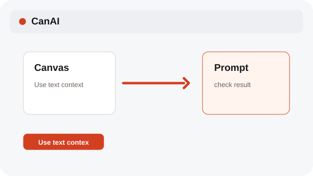

# Understand reference types

Models receive images, videos, GIF first frames, and text in different ways.

**Category:** [Canvas](./README.md#canvas)

## Steps

### 1. Use an image

Image references are sent when the selected model supports them.

### 2. Use video or GIF

Video references require a video-capable model; a GIF uses its first frame as an image reference.

### 3. Use text context

Text cards are appended as context for image/video prompts and wrapped as context for text generation.

## Notes

- The model menu shows the compatible modality. CanAI does not silently drop an unsupported reference.
- System labels follow the selected interface language; reference text and labels remain as entered.

## Related topics

- [Use Canvas references](./references.md)
- [Pick Auto or a model](./models.md)

---

[Help index](./README.md) · [README](../../README.md) · [Getting started](../../docs/GETTING-STARTED.md)
