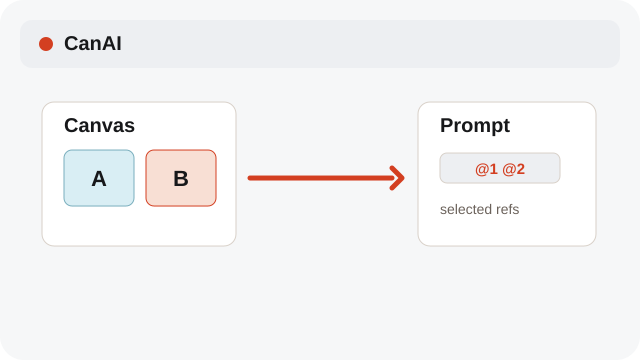
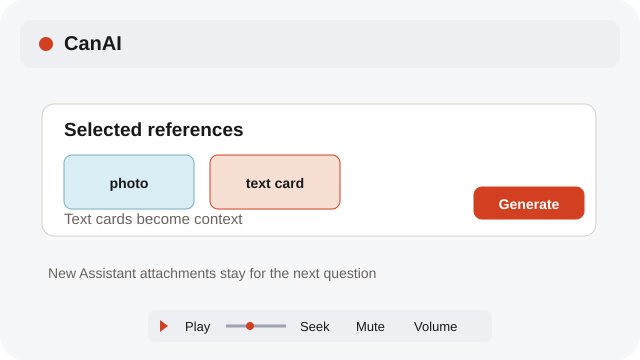
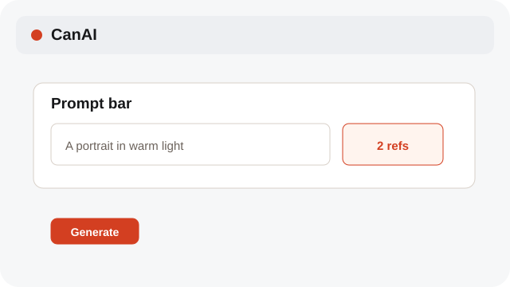

# Use Canvas references

Prompt selection can become automatic references; Assistant attachments are added deliberately.

**Category:** [Canvas](./README.md#canvas)

## Steps

### 1. Select items

Select image, video, or text cards on the Canvas. The prompt bar shows the references it can send.

### 2. Check the prompt

Auto references follow the current selection. Text cards are added as context, not uploaded media.

### 3. Generate

Choose Generate to send the prompt and its selected references together.

## Notes

- Selecting a Canvas item alone does not attach it to Assistant chat. For Assistant, drag a card into the chat or add it from Assets. Attachments added while a question is sending stay in the composer for your next question.
- Use Play or Pause below a media preview. Drag Seek to jump; Mute and Volume change its sound.
- System labels follow the selected interface language; reference text and labels remain as entered.

## Related topics

- [Attach Canvas references to Assistant](./assistant-photos.md)
- [Understand reference types](./reference-kinds.md)
- [Choose Together or Each](./generation-modes.md)

---

[Help index](./README.md) · [README](../../README.md) · [Getting started](../../docs/GETTING-STARTED.md)
