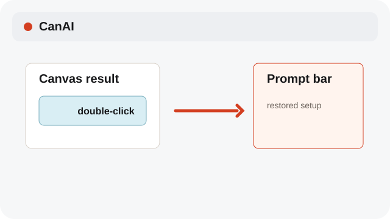
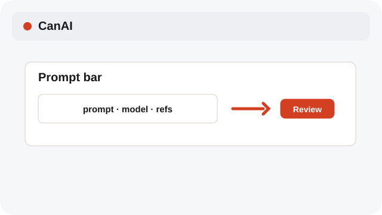
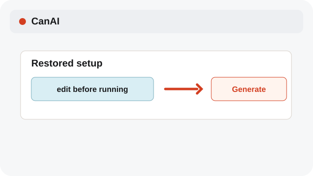

# Restore a generation setup

Double-click a generated image or video to reuse its prompt and references.

**Category:** [Generate](./README.md#generate)

## Steps

### 1. Open the result

Double-click a generated image or video card on the Canvas.

### 2. Review the setup

CanAI restores the saved prompt, model, and references into the composer.

### 3. Adjust before running

Edit the prompt or model, review the quote, and choose Generate for a new job.

## Notes

- System labels follow the selected interface language; model IDs, API values, and prompt text are preserved.

## Related topics

- [Pick Auto or a model](./models.md)
- [Track pending jobs](./pending-jobs.md)

---

[Help index](./README.md) · [README](../../README.md) · [Getting started](../../docs/GETTING-STARTED.md)
