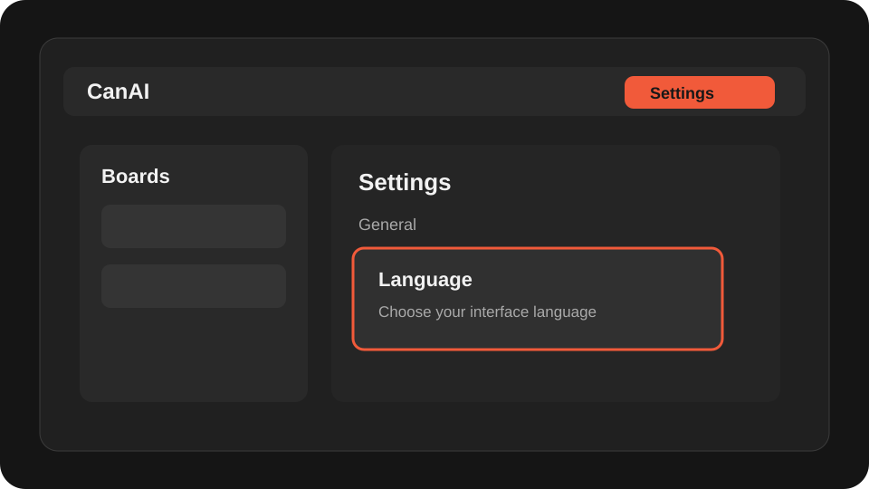
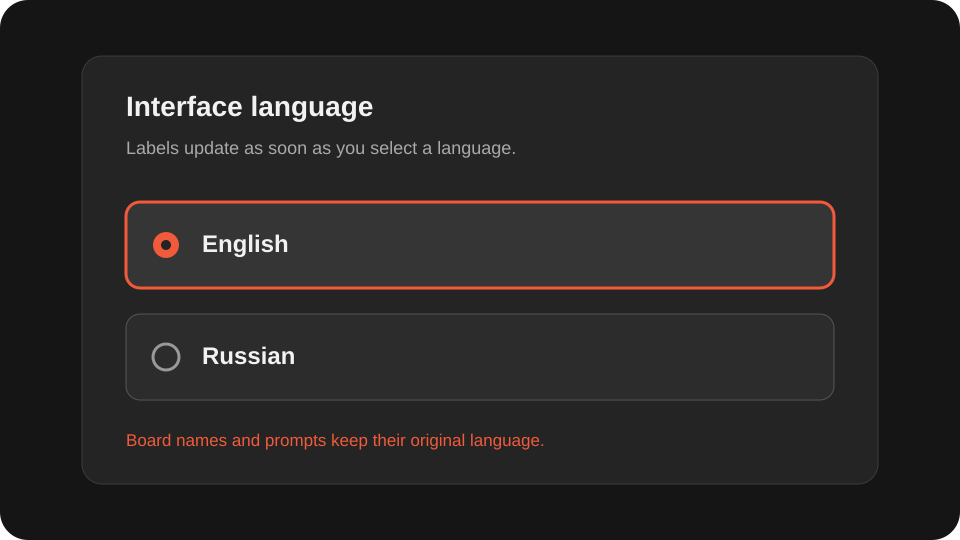
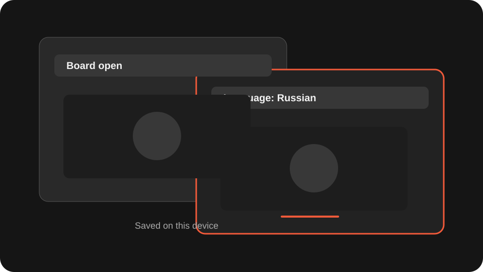

# Choose the interface language

Switch CanAI between English and Russian for this device without reopening your board.

**Category:** [Settings and access](./README.md#settings-and-access)

## Steps

### 1. Open Settings

Open Settings and stay on the General section. Your board remains open while the setting changes.

### 2. Choose English or Russian

In Language, select English or Russian. Labels and system notices update immediately, while board names, prompts, and generated content keep their original language.

### 3. Use another window

The choice is saved on this device and follows other open CanAI windows. It is a personal display preference and is never sent with a board or generation request.

## Notes

- Changing the language does not reload or remount the board.
- If browser storage is blocked, the current window still switches language until it closes.

## Related topics

- [Configure providers and models](./settings-provider.md)
- [Keep the local app portable](./settings-local.md)

---

[Help index](./README.md) · [README](../../README.md) · [Getting started](../../docs/GETTING-STARTED.md)
