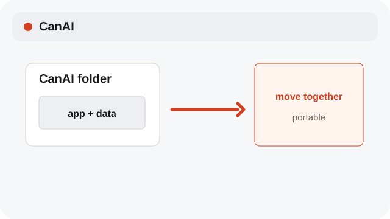
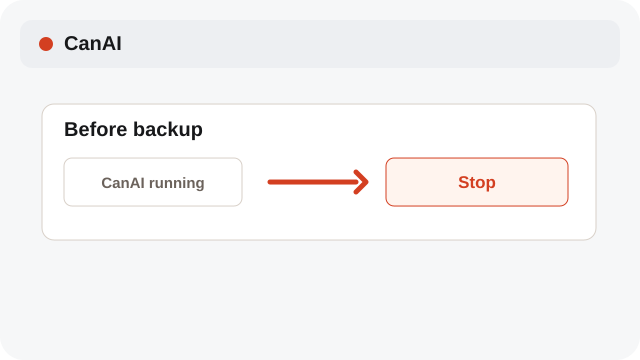
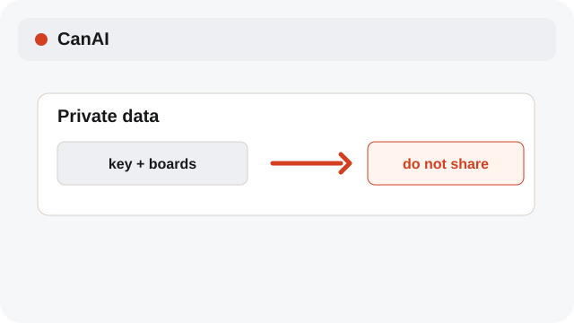

# Keep the local app portable

Keep boards, media, and settings together under the local app folder.

**Category:** [Settings and access](./README.md#settings-and-access)

## Steps

### 1. Keep the folder together

Move or copy the whole app folder when transferring a portable installation.

### 2. Stop before backup

Stop CanAI before copying the folder so active files finish writing.

### 3. Protect your data

Keep your provider key and board data private; do not include them in screenshots or shared backups.

## Notes

- A provider is contacted only when you start a request.
- The language choice is personal to this device; settings values and provider payloads do not change.

## Related topics

- [Import a .canai board](./project-files.md)
- [Configure providers and models](./settings-provider.md)

---

[Help index](./README.md) · [README](../../README.md) · [Getting started](../../docs/GETTING-STARTED.md)
