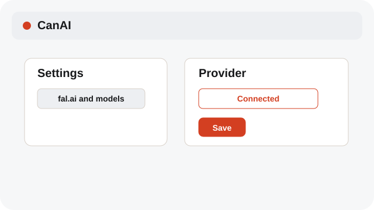
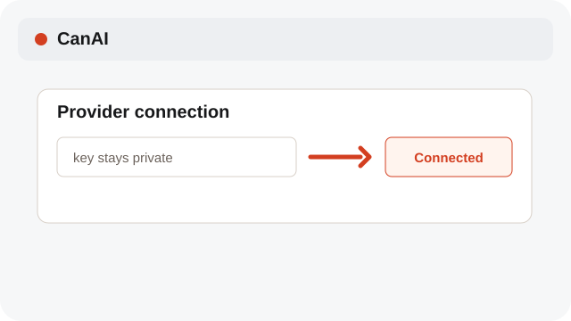
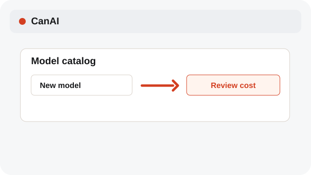

# Configure providers and models

Provider keys, catalog models, and price confirmations stay explicit.

**Category:** [Settings and access](./README.md#settings-and-access)

## Steps

### 1. Open Settings

Open Settings → fal.ai and models to see provider status and the current model catalog.

### 2. Save a key

Enter the key in the local settings form. CanAI stores only the provider configuration needed for requests.

### 3. Confirm new models

Review a new model’s parameters and cost before it becomes available for generation.

## Notes

- Generation stays unavailable until a provider is connected. Review the estimate before confirming a request.
- Connection errors use English. If the message asks for details, open Diagnostics to inspect the original server response.
- The language choice is personal to this device; settings values and provider payloads do not change.

## Related topics

- [Start a local board](./quick-start.md)
- [Pick Auto or a model](./models.md)
- [Review variants and cost](./variants-cost.md)

---

[Help index](./README.md) · [README](../../README.md) · [Getting started](../../docs/GETTING-STARTED.md)
