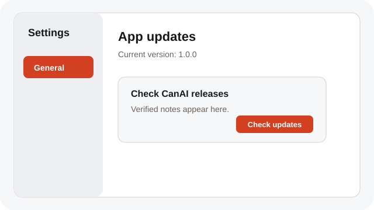
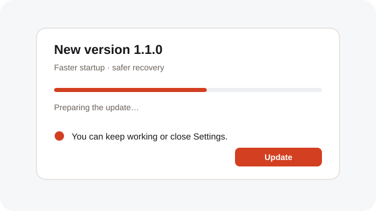
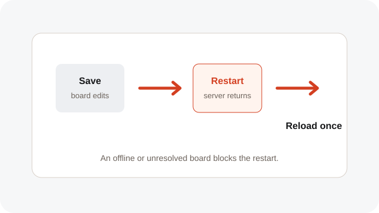

# Update the desktop app

Check a verified release, keep your board saved, and restart CanAI once.

**Category:** [Settings and access](./README.md#settings-and-access)

## Steps

### 1. Check for updates

Open Settings → General → App updates and choose Check for updates. The section shows your current version and the release notes.

### 2. Choose Update

When a verified release is available, choose Update. CanAI prepares the release while you keep working; closing Settings does not cancel preparation.

### 3. Save and restart

Before applying the release, CanAI saves the local board or waits for local edits to be confirmed. It restarts and reloads once after the server returns.

## Notes

- The tablet surface does not show desktop app updates.
- An offline local board or unresolved recovery draft blocks the restart until you reconnect or resolve it.
- The update flow does not charge for generation and does not change board content or provider settings.

## Related topics

- [Keep the local app portable](./settings-local.md)
- [Recover after a restart](./recovery.md)

---

[Help index](./README.md) · [README](../../README.md) · [Getting started](../../docs/GETTING-STARTED.md)
