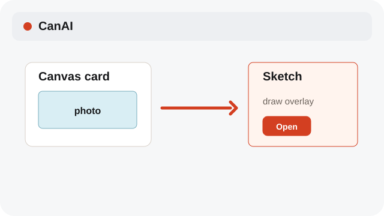
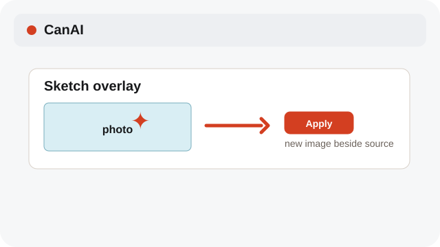
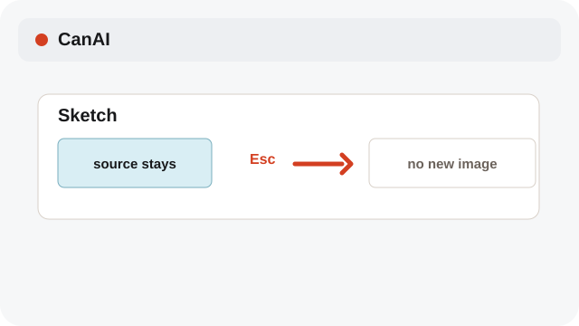

# Sketch a new image

Draw over a card and apply the drawing as a nearby copy.

**Category:** [Edit](./README.md#edit)

## Steps

### 1. Open Sketch

Choose Sketch from a selected image card’s context menu.

### 2. Draw and Apply

Draw on the overlay, then choose Apply to create a new image beside the source.

### 3. Cancel safely

Press Esc or choose Cancel to leave the source image unchanged.

## Notes

- Sketch Apply creates a new image beside the source; the source stays clean.
- System labels follow the selected interface language; edit operations preserve the source content.

## Related topics

- [Crop an image](./crop-sketch.md)
- [Use the external editor](./external-editor.md)

---

[Help index](./README.md) · [README](../../README.md) · [Getting started](../../docs/GETTING-STARTED.md)
