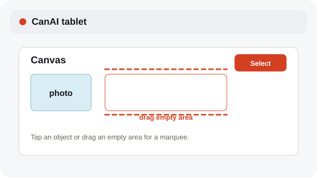
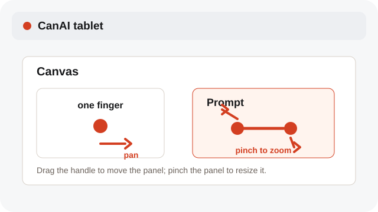
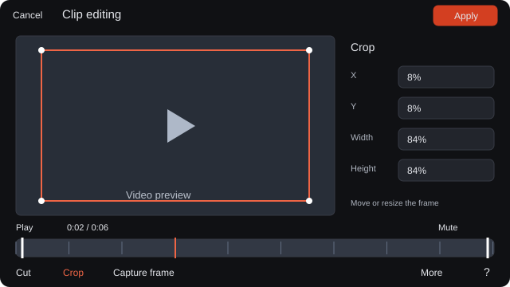
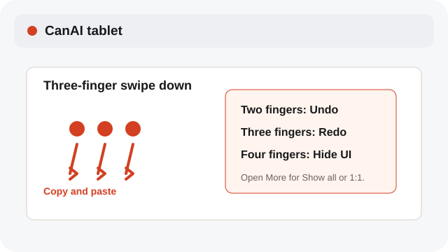

# Use tablet touch gestures

Select, pan, zoom, resize, and manage history with the tablet’s touch controls.

**Category:** [Settings and access](./README.md#settings-and-access)

## Steps

### 1. Select and frame

Tap an object to select it. Drag an empty area for a marquee; with a stylus, draw over an object to start one.

### 2. Pan and zoom

Drag an empty area with one finger to move around. Pinch with two fingers to zoom and pan without changing card size.

### 3. Open object actions

Double-tap a finished image or video to open it large. Hold an object for actions, including Resize; Apply saves one history step.

### 4. Use touch history

Two fingers undo, three fingers redo or swipe down to copy and paste, and four fingers hide the interface. More contains Show all and 1:1.

## Notes

- Drag the prompt-panel handle to move it; − and + change width, ↔ resizes the edge, and Return to bottom resets it.
- More offers Smaller interface and Larger interface; pinch the panels for a quick size change.
- Hold two fingers to undo repeatedly, or hold three fingers to redo repeatedly. Hide the interface with four fingers and tap again to restore it.
- Use Play or Pause below a media preview. Drag Seek to jump; Mute and Volume change its sound.
- Clip editing keeps a large preview and one timeline. Crop values move beside the video in landscape and collapse on narrow screens.
- Tap a name to visit their cursor or Follow to move with their view. A pan, pinch or zoom stops following.
- The tablet uses the same device language preference; board content and access settings remain unchanged.

## Shortcuts

- **Two-finger tap** — Undo
- **Three-finger swipe right** — Redo
- **Three-finger swipe down** — Copy and paste
- **Four-finger tap** — Hide or restore the interface

## Related topics

- [Use the tablet client on a LAN](./tablet-lan.md)
- [Navigate the Canvas quickly](./navigation-shortcuts.md)
- [Crop an image](./crop-sketch.md)

---

[Help index](./README.md) · [README](../../README.md) · [Getting started](../../docs/GETTING-STARTED.md)
