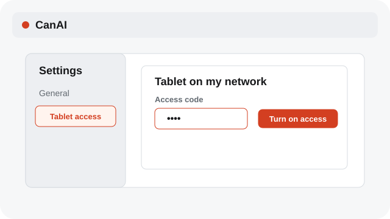
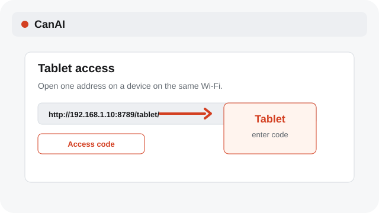
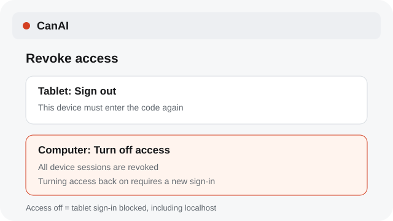

# Use the tablet client on a LAN

The tablet surface can connect to the local app on your network with deliberate access limits.

**Category:** [Settings and access](./README.md#settings-and-access)

## Steps

### 1. Open Tablet access

In Settings → Tablet access, set an access code and choose Turn on access.

### 2. Open the listed address

On the tablet, open one of the local addresses shown in Settings and enter the access code.

### 3. Keep access private

Sign out on the tablet to revoke that device’s session. Turn access off on the computer to revoke all sessions; devices must enter the code again after access is turned back on.

## Notes

- LAN access exposes the local app to devices on that network. It does not include This edition administration.
- When Tablet access is off, tablet sign-in is blocked even at its localhost address. The desktop app remains available.
- The tablet uses the same device language preference; board content and access settings remain unchanged.

## Related topics

- [Keep the local app portable](./settings-local.md)
- [Use tablet touch gestures](./tablet-gestures.md)

---

[Help index](./README.md) · [README](../../README.md) · [Getting started](../../docs/GETTING-STARTED.md)
