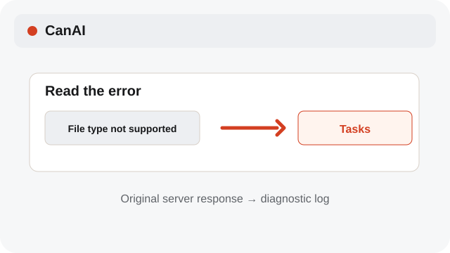
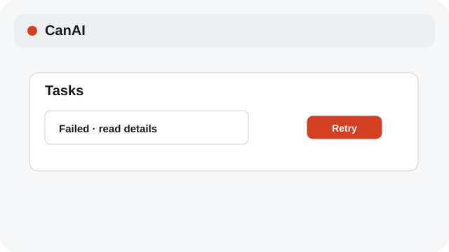
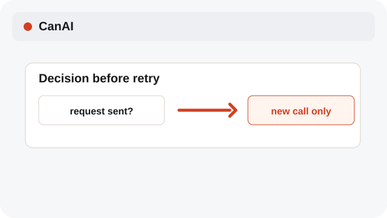

# Retry a failed job

Retry is explicit so a new provider call is never hidden.

**Category:** [Tasks](./README.md#tasks)

## Steps

### 1. Read the error

Open the task details and check whether the provider request was already sent. If an error points to the diagnostic log, check the original server response there.

### 2. Retry or edit

Choose Retry to make a new call, or restore the setup and edit the prompt first.

### 3. Confirm the new quote

Review the fresh estimate before confirming another paid generation.

## Notes

- A saved provider result can finish after a restart without a duplicate submission. A manual Retry is a new attempt.
- Task cards, tooltips, and progress messages use English, including errors saved by an older server. Diagnostics retain the original response.

## Related topics

- [Track pending jobs](./pending-jobs.md)
- [Restore a generation setup](./restore-generation.md)
- [Review variants and cost](./variants-cost.md)

---

[Help index](./README.md) · [README](../../README.md) · [Getting started](../../docs/GETTING-STARTED.md)
