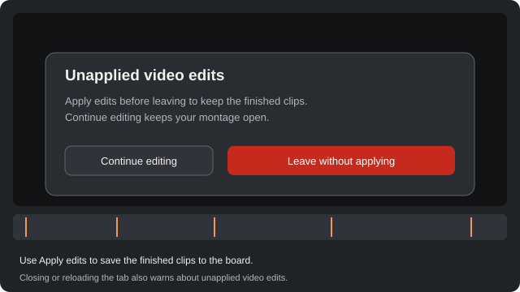
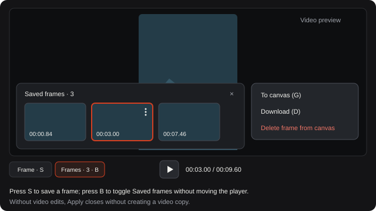

# Trim video on the timeline

The timeline keeps cuts, crops, extracted audio, and frames in one place.

**Category:** [Edit](./README.md#edit)

## Steps

### 1. Open Timeline

Select a video and open its Timeline controls.

### 2. Split, trim, and zoom

Press T to open the editor. Drag the top ruler to scrub, press C to split, X to remove or restore a segment, Q or W to trim its start or end, and F to crop. Hold Alt and scroll to zoom the timeline in time.

### 3. Apply or continue editing

Apply edits adds edited clips below the original; capturing frames makes no video copy. Before leaving, Continue editing keeps the draft; Leave without applying discards it. Closing or reloading the tab also warns about unapplied edits.

### 4. Saved frames

Press S or click Frame to save a moment to the canvas. Click Frames or press B to open the saved-frames popover over the preview without shifting the transport. The three-dot menu offers To canvas, Download, and Delete.

## Notes

- Apply edits creates video clips only when trimming, cuts, or cropping change the video. If you only viewed it or captured frames, Apply closes the viewer without a video copy. The original and captured frames stay on the canvas.
- Video, frame-saving, and export errors use English. Source filenames and clip names are kept as entered.
- On tablet, select a video and open Clip editing. Cut, Crop, and Capture frame stay below the preview.
- Drag the top ruler or playhead cap to seek cleanly; hold Alt while dragging to bypass magnetic snap. Start and End brackets trim the clip, and dragging a cut seam down joins the segments again.
- Playback previews your montage live and skips removed segments automatically. Separate audio creates an audio object on the canvas.
- Crop follows the video image. Move its frame or drag a corner; precise values appear beside the preview on wide screens.
- In tablet Clip editing, More offers Delete segment, Restore segment, captured frames, audio extraction, and Find cuts. The ? control shows editing shortcuts.
- System labels follow the selected interface language; source filenames and clip names remain as entered.

## Shortcuts

- **T** — Open timeline editing
- **C** — Cut at the cursor
- **X** — Remove or restore the segment under the cursor
- **Q / W** — Trim the segment start or end at the cursor
- **F** — Toggle the crop frame
- **S** — Capture the current frame
- **← / →** — Step back or forward one frame (Shift for 10 frames)
- **↑ / ↓** — Jump to the next or previous cut
- **Alt+scroll** — Zoom the timeline in time

## Related topics

- [Compare versions and results](./compare.md)
- [Crop an image](./crop-sketch.md)
- [Export selected results](./export.md)

---

[Help index](./README.md) · [README](../../README.md) · [Getting started](../../docs/GETTING-STARTED.md)
