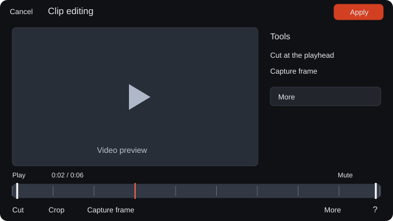
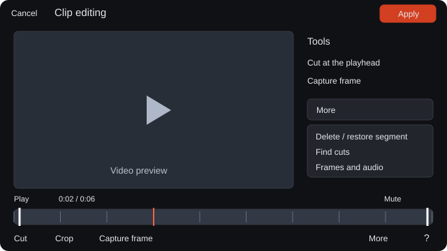
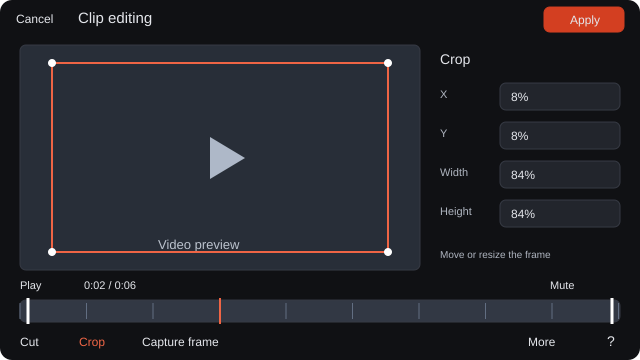

# Trim video on the timeline

The timeline keeps cuts, crops, extracted audio, and frames in one place.

**Category:** [Edit](./README.md#edit)

## Steps

### 1. Open Timeline

Select a video and open its Timeline controls.

### 2. Trim or cut

Press T to open the editor, then use Cut at cursor position, Remove segment under cursor, or Find cuts. Separate audio creates an audio object.

### 3. Capture or apply

Use Enable cropping for a crop pass, Capture frame to canvas for the current frame, and Apply edits when the timeline is ready.

## Notes

- Video, frame-saving, and export errors use English. Source filenames and clip names are kept as entered.
- On tablet, select a video and open Clip editing. Cut, Crop, and Capture frame stay below the preview.
- Drag Playback position on the single timeline to seek. Start and End trim the clip; drag a cut down to join it again.
- Crop follows the video image. Move its frame or drag a corner; precise values appear beside the preview on wide screens.
- More contains segment actions, captured frames, audio extraction, and Find cuts. The ? control shows editing shortcuts.
- In Clip editing, More offers Delete segment or Restore segment. Join at a listed time removes a cut without hiding the video.
- System labels follow the selected interface language; source filenames and clip names remain as entered.

## Shortcuts

- **T** — Open timeline editing
- **S** — Cut at the cursor
- **C** — Remove or restore the segment under the cursor
- **F** — Capture the current frame

## Related topics

- [Compare versions and results](./compare.md)
- [Crop an image](./crop-sketch.md)
- [Export selected results](./export.md)

---

[Help index](./README.md) · [README](../../README.md) · [Getting started](../../docs/GETTING-STARTED.md)
