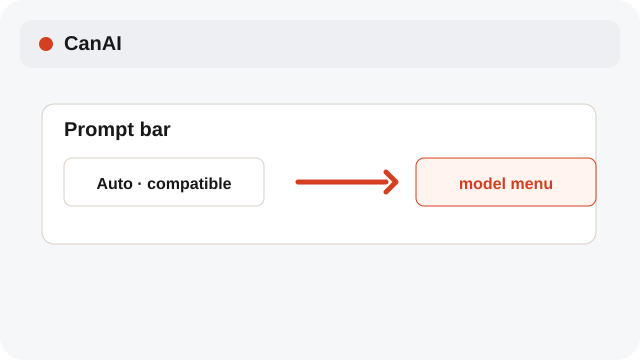
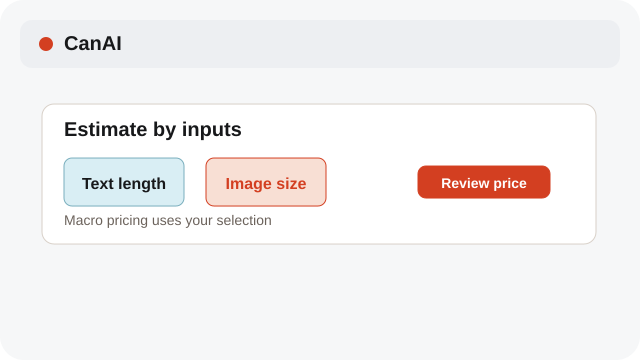
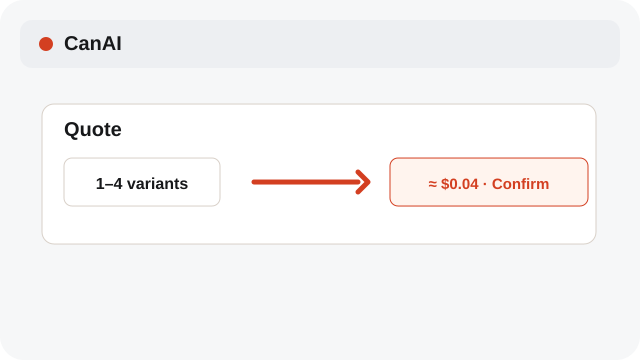

# Review variants and cost

Parallel variants are separate jobs, so the quote matters.

**Category:** [Generate](./README.md#generate)

## Steps

### 1. Set variants

Choose a count from 1 to 4 in the prompt bar when the model allows variants.

### 2. Review the estimate

The price badge shows the estimated total for the selected model and variants. Macro estimates also use selected text length and original image dimensions.

### 3. Connect deliberately

A provider connection is required before you confirm a paid generation.

## Notes

- A new attempt after a failed paid request can make another provider call. Check Tasks before retrying.

## Related topics

- [Pick Auto or a model](./models.md)
- [Track pending jobs](./pending-jobs.md)
- [Configure providers and models](./settings-provider.md)

---

[Help index](./README.md) · [README](../../README.md) · [Getting started](../../docs/GETTING-STARTED.md)
