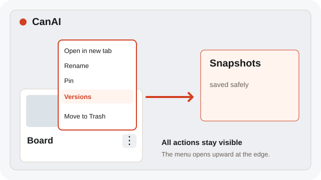
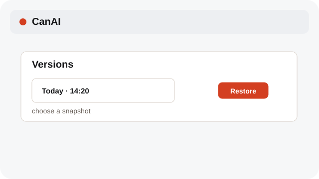
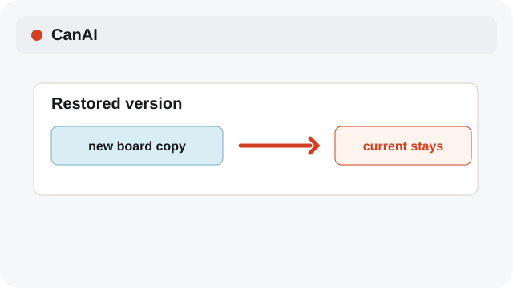

# Use board Versions

Undo is quick; Versions gives you older saved board snapshots.

**Category:** [Library](./README.md#library)

## Steps

### 1. Open Versions

Open the board's Actions menu (⋮) and choose Versions to inspect saved snapshots. Near the bottom of the window, the menu opens upward; in a short window, scroll inside the menu to reach every action.

### 2. Restore a snapshot

Choose a snapshot and confirm Restore. CanAI creates a new board from it.

### 3. Continue safely

Keep the current board open while you compare the restored copy.

## Notes

- Restoring a version never overwrites the current board. Use Undo for a single recent edit.

## Shortcuts

- **Ctrl+Z** — Undo the latest Canvas edit

## Related topics

- [Keep a board tidy](./library.md)
- [Import a .canai board](./project-files.md)

---

[Help index](./README.md) · [README](../../README.md) · [Getting started](../../docs/GETTING-STARTED.md)
