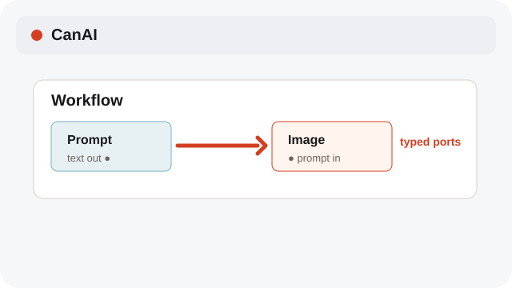
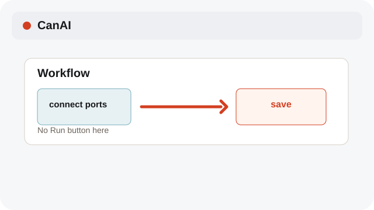
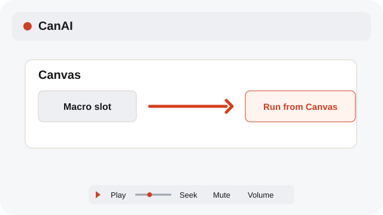

# Build a Workflow

Connect typed nodes in the Workflow editor; runs start from the Canvas macro controls.

**Category:** [Workflow and macros](./README.md#workflow-and-macros)

## Steps

### 1. Add a node

Drag a node from the palette into the Workflow editor, or use the keyboard menu.

### 2. Connect ports

Connect compatible typed ports. One input keeps one active connection.

### 3. Run from Canvas

Save the workflow, then launch its macro slot from the Canvas. The editor itself has no Run button.

## Notes

- Nodes preserve their IDs, schemas, and typed values when a workflow is saved.
- Connection errors use English. Your node labels, prompts, and Macro names keep their original language.
- Use Play or Pause below a media preview. Drag Seek to jump; Mute and Volume change its sound.
- System labels follow the selected interface language; node labels, prompts, and Macro names remain as entered.

## Related topics

- [Run and stop macros](./macros.md)
- [Manage the Macro Library](./macro-library.md)

---

[Help index](./README.md) · [README](../../README.md) · [Getting started](../../docs/GETTING-STARTED.md)
